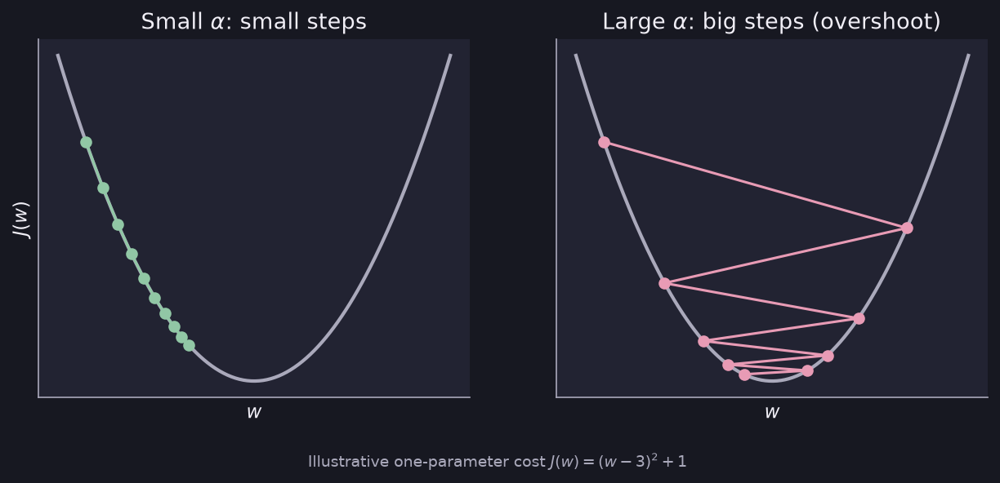

# Linear Regression

> **Source page:** 14 · The first topic of *Course I: Supervised ML, Regression and Classification*. Linear regression predicts a number from an input by fitting a straight line.

## 1. The model (univariate)

With a single input feature $x$ the model is a straight line:

$$
f_{w,b}(x) = wx + b
$$

- $w$ is the **weight**.
- $b$ is the **bias**.

*(The source writes the left-hand side as $f(w,b)$.)*

## 2. Cost function

The cost function measures how badly the line fits the data. The goal is to **minimise** it.

$$
J(w,b) = \frac{1}{2m}\sum_{n=0}^{m}\left(f_{w,b}-y\right)^2
$$

> **Note on the source:** the page writes the sum from $n=0$ to $m$ and leaves out the example index on $f$ and $y$. This is preserved above exactly as written.

> **Additional Explanation:**  
> This explanation has been added to improve understanding and is not a direct transcription of the original handwritten notes.  
> The same cost is normally written with the sum running over the $m$ training examples, $i=1,\dots,m$, and with the prediction and target of each example:
> $$J(w,b) = \frac{1}{2m}\sum_{i=1}^{m}\left(f_{w,b}(x^{(i)})-y^{(i)}\right)^2$$
> Each term is the squared gap between the prediction and the true value. This is the form used from here onwards.

## 3. Gradient descent

Gradient descent is the algorithm used to **minimise the cost**. It repeatedly updates both parameters:

$$
w = w - \alpha\,\frac{\partial J(w,b)}{\partial w}
$$

$$
b = b - \alpha\,\frac{\partial J(w,b)}{\partial b}
$$

$\alpha$ is the **learning rate**:

| Learning rate | Effect on step size |
|---|---|
| Large | Step size increases (↑) |
| Small | Step size decreases (↓) |

*Figure: with a small $\alpha$ each step is small; with a large $\alpha$ the steps are big and can overshoot the minimum (illustrative cost, not from the source).*

> **Additional Explanation:**  
> This explanation has been added to improve understanding and is not a direct transcription of the original handwritten notes.  
> Both parameters are normally updated *simultaneously*: compute both partial derivatives with the current $w,b$ first, then assign the new values.

## Detailed Explanation

> **Additional Explanation:**  
> This explanation has been added to improve understanding and is not a direct transcription of the original handwritten notes.
>
> **The big idea.** Suppose you want to predict the price of a house from its size. Linear regression draws the straight line that best follows the data. Once the line is drawn, you can read off a price for any new size. The line is controlled by two numbers: $w$ (how steep it is) and $b$ (where it crosses the vertical axis).
>
> **Why we need a cost function.** Many lines are possible, so we need one number that says how bad a line is. For every training example we take *prediction minus true value*. We square it so that errors above and below the line do not cancel, and so that big mistakes count more. We then average over the $m$ examples. The extra $\frac{1}{2}$ is only for convenience: when we take the derivative, the 2 from the square cancels it.
>
> **Worked example (made-up data).** Take three examples: $(x,y) = (1,1), (2,2), (3,3)$.
>
> - With $w=1,\ b=0$ the line passes through every point, so $J=0$. This is the best possible line.
> - With $w=0.5,\ b=0$ the predictions are $0.5, 1, 1.5$. The errors are $-0.5, -1, -1.5$, the squares are $0.25, 1, 2.25$ (sum $3.5$), so $J = 3.5/(2\cdot 3) \approx 0.583$.
>
> **One step of gradient descent on that bad line** ($w=0.5,\ b=0,\ \alpha=0.1$).
>
> - $\frac{\partial J}{\partial w} = \frac{1}{3}\left[(-0.5)(1)+(-1)(2)+(-1.5)(3)\right] = -2.33$
> - $\frac{\partial J}{\partial b} = \frac{1}{3}(-0.5-1-1.5) = -1$
> - New values: $w = 0.5 - 0.1(-2.33) \approx 0.733$ and $b = 0 - 0.1(-1) = 0.1$.
>
> Both numbers moved towards the better line ($w=1,\ b=0$). The derivative is negative, so subtracting it *increases* the parameter.
>
> **How to read the derivative.** The derivative tells you which way the cost goes up. Gradient descent walks the opposite way, downhill, a little at a time.
>
> **Common mistakes.**
>
> - Updating $w$ first and then using the *new* $w$ to update $b$. Both updates must use the old values.
> - Using a learning rate that is too large, so the cost goes up instead of down.
> - Forgetting that the cost is measured on the *training* data only.

## 4. Related topics

- Next: [Multiple features and vectorization](02-multiple-features-and-vectorization.md)
- How to pick $\alpha$ and check that gradient descent works: [Gradient descent in practice](04-gradient-descent-in-practice.md)