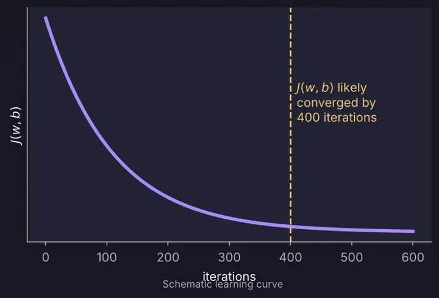
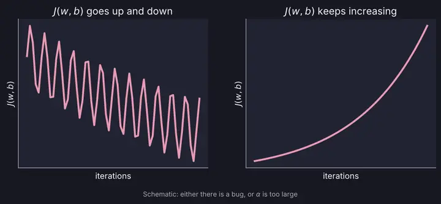

# Gradient Descent in Practice

> **Source pages:** 6 (bottom, "Checking convergence for gradient decent"), 8 (top, note on learning rate) · How to tell that gradient descent is working and how to choose $\alpha$.

## 1. Checking convergence

Plot the cost $J(w,b)$ against the number of iterations. The cost should decrease on every iteration.

*Figure: the source's sketch shows $J(w,b)$ flattening out; it is "likely converged by 400 iterations" (schematic redrawing).*

**Automatic convergence test (from the source):** let $\varepsilon = 10^{-3}$. If $J(w,b)$ decreases by $\le \varepsilon$ in one iteration, declare convergence.

## 2. When the cost misbehaves

If $J(w,b)$ goes up and down, or keeps increasing, then **there is a bug, or $\alpha$ is too large**.

*Figure: the two situations drawn in the source note — a zig-zagging cost and a steadily increasing cost.*

## 3. Values of $\alpha$ to try

$$
0.001,\ 0.003,\ 0.01,\ 0.03,\ \dots
$$

Each value is roughly **3×** the previous one (the source marks each step with "≈3×").

## 4. Related topics

- Previous: [Feature scaling](03-feature-scaling.md)
- Next: [Feature engineering and polynomial regression](05-feature-engineering-and-polynomial-regression.md)
- A way of adapting $\alpha$ automatically: [Adam algorithm](../02-advanced-learning-algorithms/08-adam-and-layer-types.md)