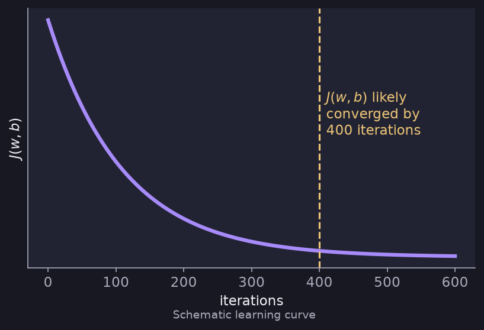
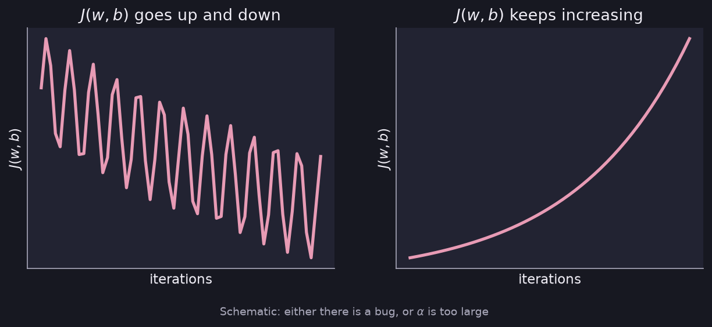

# Gradient Descent in Practice

> **Source pages:** 6 (bottom, "Checking convergence for gradient decent"), 8 (top, note on learning rate) · How to tell that gradient descent is working and how to choose $\alpha$.

## 1. Checking convergence

Plot the cost $J(w,b)$ against the number of iterations. The cost should decrease on every iteration.

*Figure: the source's sketch shows $J(w,b)$ flattening out; it is "likely converged by 400 iterations" (schematic redrawing).*

**Automatic convergence test (from the source):** let $\varepsilon = 10^{-3}$. If $J(w,b)$ decreases by $\le \varepsilon$ in one iteration, declare convergence.

## 2. When the cost misbehaves

If $J(w,b)$ goes up and down, or keeps increasing, then **there is a bug, or $\alpha$ is too large**.

*Figure: the two situations drawn in the source note — a zig-zagging cost and a steadily increasing cost.*

## 3. Values of $\alpha$ to try

$$
0.001,\ 0.003,\ 0.01,\ 0.03,\ \dots
$$

Each value is roughly **3×** the previous one (the source marks each step with "≈3×").

## Detailed Explanation

> **Additional Explanation:**  
> This explanation has been added to improve understanding and is not a direct transcription of the original handwritten notes.
>
> **Why plot the cost.** Gradient descent is only useful if the cost really goes down. Plotting $J$ against the iteration number is the quickest health check. If every iteration makes $J$ smaller, things are working.
>
> **The stopping rule, step by step.** The source uses $\varepsilon = 10^{-3} = 0.001$. Suppose $J$ is $0.5000$ after one iteration and $0.4995$ after the next. The drop is $0.0005$, which is $\le 0.001$, so we declare convergence. A small $\varepsilon$ makes you wait longer for a slightly better answer; a large one stops early.
>
> **Reading the two bad curves.**
>
> - *Zig-zag:* each step jumps over the bottom of the valley to the other side, then back. The step is too big.
> - *Always rising:* each step jumps so far that it lands higher than where it started. Again the step is too big, or the code has a sign error (for example $+\alpha$ instead of $-\alpha$).
>
> **A quick debugging trick.** Run with a very small $\alpha$. If $J$ still does not decrease on every iteration, the problem is a bug, not the learning rate.
>
> **How to search for $\alpha$.** Try $0.001$, then about three times larger each time: $0.003,\ 0.01,\ 0.03,\ 0.1,\dots$ Run a few iterations for each and look at the curve. Choose the largest value that still gives a smooth, steadily falling curve, because it reaches the bottom fastest.
>
> **Common mistakes.**
>
> - Judging convergence by the number of iterations alone. The number needed changes a lot between problems (30 for one, 100 000 for another).
> - Changing the data scaling and the learning rate at the same time, so you cannot tell which helped.

## 4. Related topics

- Previous: [Feature scaling](03-feature-scaling.md)
- Next: [Feature engineering and polynomial regression](05-feature-engineering-and-polynomial-regression.md)
- A way of adapting $\alpha$ automatically: [Adam algorithm](../02-advanced-learning-algorithms/08-adam-and-layer-types.md)