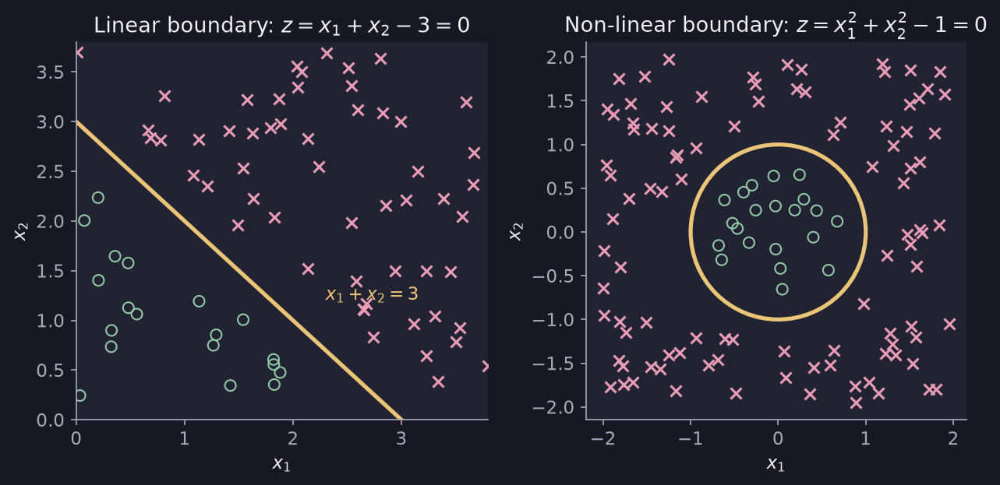

# Decision Boundary

> **Source page:** 3 (top) · Where a classification model switches from predicting one class to the other.

## 1. Linear boundary

The model first computes

$$
z = \vec w\cdot\vec x + b
$$

The boundary is where $z=0$. The source's example:

$$
z = x_1 + x_2 - 3 = 0 \quad\Longrightarrow\quad x_1 + x_2 = 3
$$

This is a straight line. In the source's sketch the points marked **o** lie on one side of it and the points marked **x** on the other.

## 2. Non-linear boundaries

Using squared features gives a curved boundary:

$$
f(\vec x) = g\left(w_1x_1^2 + w_2x_2^2 + b\right)
$$

$$
z = x_1^2 + x_2^2 - 1 \quad\Longrightarrow\quad x_1^2 + x_2^2 = 1
$$

This is a circle. In the source's sketch the **o** points are inside the circle and the **x** points are outside.

*Figure: left, the line $x_1+x_2=3$; right, the circle $x_1^2+x_2^2=1$. The points are synthetic and only illustrate the two examples drawn in the source.*

> **Additional Explanation:**  
> This explanation has been added to improve understanding and is not a direct transcription of the original handwritten notes.  
> Here $g$ is the sigmoid function (defined in [Logistic loss and cost](07-logistic-loss-and-cost.md)). Since $g(0)=0.5$, the boundary is the set of points where $z=0$.

## Detailed Explanation

> **Additional Explanation:**  
> This explanation has been added to improve understanding and is not a direct transcription of the original handwritten notes.
>
> **What the boundary means.** The model outputs a number $f(\vec x)=g(z)$ between 0 and 1, which we read as the chance that $y=1$. We predict class 1 when $f\ge 0.5$ and class 0 otherwise. Because the sigmoid gives exactly $0.5$ at $z=0$, the dividing line between the two predictions is the set of points where $z=0$.
>
> **Worked example 1: the line** $z = x_1 + x_2 - 3$ (so $w_1=w_2=1,\ b=-3$). Treat the **x** points as class 1.
>
> - Point $(1,1)$: $z = 1+1-3 = -1 < 0$, so it is on the **o** side (class 0).
> - Point $(3,2)$: $z = 3+2-3 = 2 > 0$, so it is on the **x** side (class 1).
> - Point $(2,1)$: $z=0$, exactly on the boundary.
>
> **Worked example 2: the circle** $z = x_1^2 + x_2^2 - 1$.
>
> - Point $(0.5, 0.5)$: $z = 0.25+0.25-1 = -0.5 <0$, so it is inside the circle (**o**).
> - Point $(2, 0)$: $z = 4 - 1 = 3 > 0$, so it is outside the circle (**x**).
>
> **Why squared features give a curve.** The boundary is still "$z=0$", but now $z$ is made from $x_1^2$ and $x_2^2$. A straight line in the *new* features becomes a curve in the original picture. This is the same trick as [polynomial regression](05-feature-engineering-and-polynomial-regression.md).
>
> **Common mistake.** Thinking the boundary is where $f=1$. It is where $f=0.5$, the point of maximum uncertainty.

## 3. Related topics

- Next: [Logistic loss and cost](07-logistic-loss-and-cost.md)