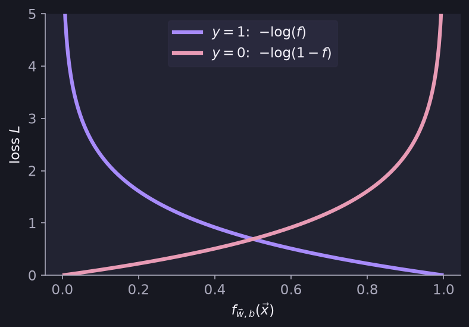
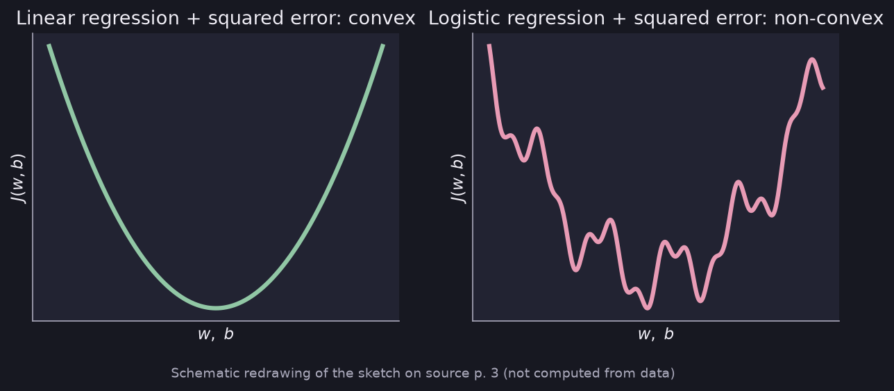

# Logistic Loss, Cost and Gradient Descent

> **Source pages:** 2 (logistic loss, simplified loss), 3 (bottom, why MSE cannot be used), 5 (cost and gradient descent) · The loss and cost used for logistic regression.

## 1. Logistic loss (log loss)

For one training example the loss is

$$
L\left(f_{\vec w,b}(\vec x^{(i)}),\,y^{(i)}\right) =
\begin{cases}
-\log\left(f_{\vec w,b}(\vec x^{(i)})\right) & \text{if } y^{(i)}=1\\[4pt]
-\log\left(1-f_{\vec w,b}(\vec x^{(i)})\right) & \text{if } y^{(i)}=0
\end{cases}
$$

### Why $-\log$?

The source's sketch of $-\log(f)$ and the notes beside it say (for the case $y^{(i)}=1$):

- As $f_{\vec w,b}(\vec x^{(i)}) \to 1$, the loss $\to 0$.
- As $f_{\vec w,b}(\vec x^{(i)}) \to 0$, the loss $\to \infty$.

**Therefore the loss is lowest when $f_{\vec w,b}(\vec x)$ predicts close to the true label $y^{(i)}$.**

*Figure: $-\log(f)$ (for $y=1$) and $-\log(1-f)$ (for $y=0$). Each is near 0 when the prediction matches the label and grows very large when it does not.*

## 2. Simplified loss function

The two cases combine into one expression:

$$
L\left(f_{\vec w,b}(\vec x^{(i)}),\,y^{(i)}\right) = -y^{(i)}\log\left(f_{\vec w,b}(\vec x)\right) - \left(1-y^{(i)}\right)\log\left(1-f_{\vec w,b}(\vec x)\right)
$$

> **Additional Explanation:**  
> This explanation has been added to improve understanding and is not a direct transcription of the original handwritten notes.  
> When $y^{(i)}=1$ the second term vanishes, and when $y^{(i)}=0$ the first term vanishes, so this single line reproduces both cases above.

## 3. Why we cannot take MSE as the cost function

The source compares the shape of the cost curve:

| Model | Cost | Shape |
|---|---|---|
| Linear regression | squared error | **Convex** |
| Logistic regression | squared error | **Non-convex** (many bumps) |

A non-convex cost has several dips, so gradient descent can get stuck. This is why the log loss above is used instead.

*Figure: schematic redrawing of the source's two sketches.*

## 4. Cost function

$$
J(\vec w,b) = -\frac{1}{m}\sum_{i=1}^{m}\left[y^{(i)}\log\left(f(\vec x^{(i)})\right) + \left(1-y^{(i)}\right)\log\left(1-f(\vec x^{(i)})\right)\right]
$$

> **Note on the source:** on the page the superscripts $(i)$ are not written on every term (for example $f(x)$ instead of $f(x^{(i)})$). They are added here for consistency.

## 5. Gradient descent

$$
\text{repeat}\ \{
$$

$$
w_j = w_j - \alpha\,\frac{\partial J}{\partial w_j}\quad(j=1,2,3,\dots,n)
\qquad
b = b - \alpha\,\frac{\partial J}{\partial b}
$$

$$
\}
$$

with the derivatives written in the source as

$$
\frac{\partial J}{\partial w_j} = \frac{1}{m}\sum_{i=1}^{m}\left(f(\vec x^{(i)})-y^{(i)}\right)x_j^{(i)}
\qquad
\frac{\partial J}{\partial b} = \frac{1}{m}\sum_{i=1}^{m}\left(f(\vec x^{(i)})-y^{(i)}\right)
$$

where

$$
f(\vec x) = \frac{1}{1+e^{-(\vec w\cdot\vec x+b)}}
$$

> **Additional Explanation:**  
> This explanation has been added to improve understanding and is not a direct transcription of the original handwritten notes.  
> These updates look the same as those of linear regression; the difference is the definition of $f$, which here is the sigmoid of $\vec w\cdot\vec x+b$.

## 6. Related topics

- Previous: [Decision boundary](06-decision-boundary.md)
- Next: [Overfitting](08-overfitting.md)
- The same loss written in code: [TensorFlow and model training steps](../02-advanced-learning-algorithms/06-tensorflow-and-training-steps.md)