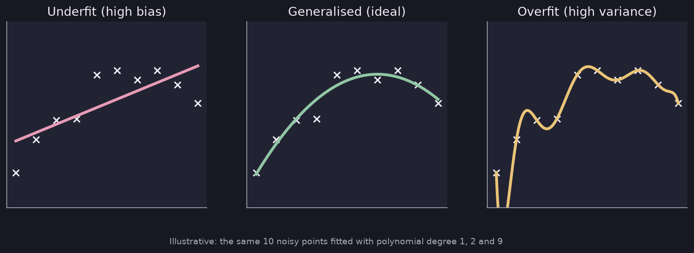

# Overfitting

> **Source page:** 4 · What goes wrong when a model fits the training data too closely, and three ways to overcome it.

## 1. Regression example

The source draws the same data fitted three ways:

| Fit | Label in the source | What it means |
|---|---|---|
| Straight line that misses the pattern | **Underfit** — high bias | The model is too simple. |
| Smooth curve through the data | **Generalized** — ideal | Fits the pattern and should work on new data. |
| Wiggly curve through every point | **Overfit** — high variance | The model memorises the training data. |

*Figure: the three cases from the source, redrawn with synthetic data.*

## 2. How to overcome overfitting

1. **Collecting more training samples** — with more data the fitted curve becomes smoother.
2. **Selecting features / reducing features.**
3. **Regularization** — reduce the size of the parameters $w_j$.

*(The source marks "diagrams →" next to item 3, pointing to the sketches in [Regularization](09-regularization.md).)*

## Detailed Explanation

> **Additional Explanation:**  
> This explanation has been added to improve understanding and is not a direct transcription of the original handwritten notes.
>
> **An everyday comparison.** A student who memorises last year's exam answers does perfectly on those exact questions but fails new questions. That is overfitting: great on the training data, poor on new data. A student who does not study at all (underfitting) does badly everywhere.
>
> **How to recognise each case.**
>
> | Case | Training error | Error on new data | Common name |
> |---|---|---|---|
> | Underfit | high | high | high bias |
> | Good fit | low | low | generalizes well |
> | Overfit | very low | much higher | high variance |
>
> **Why "bias" and "variance".** A high-bias model has a strong built-in assumption (for example "it is a straight line") that may be wrong. A high-variance model changes a lot if you change a few training points, because it follows the noise.
>
> **The three remedies, explained.**
>
> 1. *More training data.* With more points, a wiggly curve cannot pass through all of them, so it is forced to be smoother.
> 2. *Fewer features.* Fewer features mean a simpler model with less freedom to chase noise. The cost is that you might throw away something useful.
> 3. *Regularization.* Keep all the features but stop the weights from becoming large. This is usually the gentlest option (see [Regularization](09-regularization.md)).
>
> **Common mistake.** Judging a model only by its training error. Always check performance on data the model has not seen (see [Train / CV / Test](../03-model-evaluation-and-ml-practice/01-train-cv-test.md)).

## 3. Related topics

- Next: [Regularization](09-regularization.md)
- Diagnosing bias and variance: [Bias and variance](../03-model-evaluation-and-ml-practice/03-bias-and-variance.md)