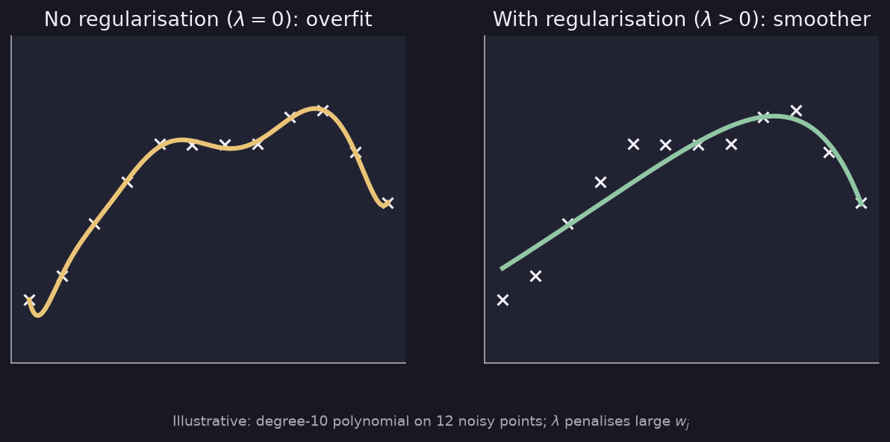

# Regularization

> **Source pages:** 37 (regularized cost function), 35 (regularized linear and logistic regression) · Keeping the parameters $w_j$ small to reduce overfitting.

## 1. Intuition

The source sketches a quadratic fit $w_1x + w_2x^2 + b$ and a wiggly fit $w_1x+w_2x^2+w_3x^3+w_4x^4+b$, and draws an arrow from the wiggly curve to a smoother one.

To make $w_3$ and $w_4$ small, **penalize** them:

$$
\frac{1}{2m}\sum\left(f(x)-y\right)^2 + 1000\,w_3^2 + 1000\,w_4^2
$$

> In order for the cost to be lower, $w_3$ and $w_4$ have to be small, as their coefficient is big.

*Figure: the same overfitting polynomial without and with a penalty on large weights (synthetic data).*

The source also shows how the coefficients change when a curve is smoothed, for example from $f(x)=28x_1-385x_2^2+39x_3^3$ to $f(x)=13x_1-0.23x_2^2+0.000014x_3^3$.

> **Note on the source:** these coefficients are read from the handwriting and could contain misread digits; they only illustrate that large coefficients become small.

## 2. Regularized cost function

If we don't know which $w_j$ to penalize, penalize all of them:

$$
J = \frac{1}{2m}\sum_{i=1}^{m}\left(f(x^{(i)})-y^{(i)}\right)^2 + \underbrace{\frac{\lambda}{2m}\sum_{j=1}^{n}w_j^2}_{\text{regularization term}}
$$

- $\lambda$ is the **regularization parameter**.
- The $2m$ is just for scaling.

## 3. Regularized linear regression

$$
\min_{\vec w,b} J(\vec w,b) = \min_{\vec w,b}\left[\frac{1}{2m}\sum_{i=1}^{m}\left(f(x^{(i)})-y^{(i)}\right)^2 + \frac{\lambda}{2m}\sum_{j=1}^{n}w_j^2\right]
$$

Gradient descent:

$$
w_j = w_j - \alpha\,\frac{\partial J}{\partial w_j},\qquad
\frac{\partial J}{\partial w_j} = \frac{1}{m}\sum_{i=1}^{m}\left(f(x^{(i)})-y^{(i)}\right)x_j^{(i)} + \underbrace{\frac{\lambda}{m}w_j}_{\text{regularized}}
$$

$$
b = b - \alpha\,\frac{\partial J}{\partial b},\qquad
\frac{\partial J}{\partial b} = \frac{1}{m}\sum_{i=1}^{m}\left(f(x^{(i)})-y^{(i)}\right)
$$

## 4. Regularized logistic regression

$$
J = -\frac{1}{m}\sum_{i=1}^{m}\left[y^{(i)}\log\left(f(x^{(i)})\right) + \left(1-y^{(i)}\right)\log\left(1-f(x^{(i)})\right)\right] + \frac{\lambda}{2m}\sum_{j=1}^{n}w_j^2
$$

Gradient descent:

$$
w_j = w_j - \alpha\,\frac{\partial J}{\partial w_j},\qquad
\frac{\partial J}{\partial w_j} = \frac{1}{m}\left(f(x)-y\right)x + \frac{\lambda}{m}w_j
$$

**$b$ is the same** as in the unregularized case.

> **Note on the source:** in the logistic cost the page has no brackets around the two log terms (the minus sign is written only in front of the first), and the derivative is written without a summation sign. Both are completed above in the usual way; see [TRANSCRIPTION_NOTES](../TRANSCRIPTION_NOTES.md).

## Detailed Explanation

> **Additional Explanation:**  
> This explanation has been added to improve understanding and is not a direct transcription of the original handwritten notes.
>
> **Why small weights give smooth curves.** To make a curve twist sharply you need big coefficients, especially on high powers like $x^3$ and $x^4$. If we punish large weights, the model can no longer afford sharp twists, so the curve relaxes.
>
> **What $\lambda$ does.** The new cost is a balance between two goals: fit the data (first term) and keep the weights small (second term). $\lambda$ sets how much each goal matters.
>
> | $\lambda$ | What happens |
> |---|---|
> | $0$ | No penalty, so it can overfit. |
> | Moderate | Good balance. |
> | Very large | All weights are pushed close to 0, so $f\approx b$, a flat line. This underfits. |
>
> **Why only $w_j$ and not $b$.** The sums in the notes run over $j=1..n$ and do not include $b$. The bias only shifts the whole curve up or down and does not make it wiggle.
>
> **What the extra term does inside gradient descent.** Write the update out:
>
> $$ w_j = w_j - \alpha\left[\frac{1}{m}\sum\left(f-y\right)x_j + \frac{\lambda}{m}w_j\right] = w_j\left(1-\alpha\frac{\lambda}{m}\right) - \alpha\frac{1}{m}\sum\left(f-y\right)x_j $$
>
> So each step first **shrinks** $w_j$ slightly by the factor $\left(1-\alpha\lambda/m\right)$, then applies the usual correction. With $\alpha=0.01,\ \lambda=1,\ m=50$ the factor is $1-0.0002 = 0.9998$, a tiny shrink at every step, which adds up over many iterations.
>
> **The source's "1000" example.** Putting a large coefficient (1000) on $w_3^2$ and $w_4^2$ forces those two weights to be almost 0. $\lambda$ does the same for *all* weights when we do not know which ones to punish.
>
> **Common mistakes.**
>
> - Choosing $\lambda$ by looking at the training error. Choose it using the cross-validation set (see [Bias and variance](../03-model-evaluation-and-ml-practice/03-bias-and-variance.md)).
> - Forgetting that scaled features are needed, or the penalty hits the large-range features unfairly.

## 5. Related topics

- Previous: [Overfitting](08-overfitting.md)
- Choosing $\lambda$: [Bias and variance](../03-model-evaluation-and-ml-practice/03-bias-and-variance.md) and [Debugging a learning algorithm](../03-model-evaluation-and-ml-practice/04-learning-curves-and-debugging.md)
- Cost evaluation excludes the regularization term: [Train / cross-validation / test](../03-model-evaluation-and-ml-practice/01-train-cv-test.md)