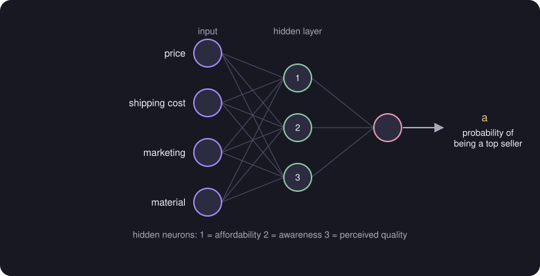
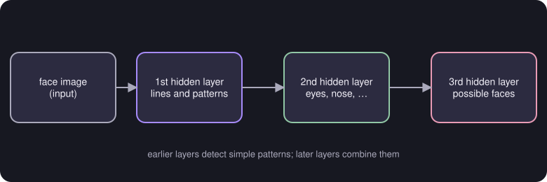

# Neural Networks

> **Source page:** 40 · The start of *Course 2: Advanced Learning Algorithms*.

## 1. Demand prediction

**Example (from the source):** finding out whether a t-shirt will be a top seller or not.

- **Input** features: price, shipping cost, marketing, material.
- **Hidden layer** neurons: affordability, awareness, perceived quality.
- **Output**: $a$ = the probability of being a top seller.

*Figure: inputs feed a hidden layer of three neurons, which feed one output neuron giving the probability of being a top seller.*

## 2. Layers and notation

The source draws a network with an input $\vec x$, three hidden layers and one output neuron. It is also called a **multilayer perceptron** (written "multilayer perception" on the page).

$$
a_j^{[l]} = g\left(\vec w_j^{[l]}\cdot\vec a^{[l-1]} + b_j^{[l]}\right)
$$

- $a^{[n]}$ is the **activation** of the $n$-th layer.
- $g$ is the activation function (see [Activation functions](03-activation-functions.md)).
- $j$ indexes the neuron within layer $l$.

## 3. Image recognition

The source's second example shows how layers build up features: an input image goes through layers that pick up **lines and patterns**, then parts such as **eyes and nose**, then **possible faces**.

*Figure: later layers combine the simple patterns found by earlier layers.*

> **Note on the source:** the labels on the middle layer of the sketch are hard to read; "eyes, nose, …" is the clearest reading ([UNCLEAR IN SOURCE], p. 40).

## Detailed Explanation

> **Additional Explanation:**  
> This explanation has been added to improve understanding and is not a direct transcription of the original handwritten notes.
>
> **The idea.** A single neuron is like one small logistic regression: it takes numbers in, forms a weighted sum, and squashes the result with an activation function. A layer is several neurons that all look at the same inputs. A network stacks layers so that the output of one layer becomes the input of the next.
>
> **Why hidden layers help.** In the t-shirt example you could try to design features by hand (affordability, awareness, perceived quality). A neural network *learns* such helpful features by itself. Each hidden neuron decides how much to use each input, and training adjusts those choices. The names in the source sketch are only a way of explaining what a hidden neuron *might* represent.
>
> **Reading the notation.** In $a_j^{[l]} = g\left(\vec w_j^{[l]}\cdot\vec a^{[l-1]} + b_j^{[l]}\right)$:
>
> - $l$ is the layer number, in square brackets;
> - $j$ is which neuron in that layer;
> - $\vec a^{[l-1]}$ is the previous layer's output, with $\vec a^{[0]}=\vec x$ (the input);
> - $g$ is the activation function.
>
> **Counting parameters (4 inputs, 3 hidden, 1 output).** Layer 1 has $4\times 3 = 12$ weights and 3 biases. Layer 2 has $3\times 1=3$ weights and 1 bias. The total is $12+3+3+1 = 19$ parameters. Every neuron has its own weight vector and its own bias.
>
> **Why image recognition works this way.** Early layers pick up simple things such as edges, middle layers combine them into parts, and later layers combine parts into whole objects.
>
> **Common mistakes.**
>
> - Mixing up the bracket $[l]$ (layer) with the round bracket $(i)$ (training example).
> - Thinking the hidden neurons have fixed meanings. They are learned.

## 4. Related topics

- Next: [Layer computation](02-layer-computation.md)
- Comparison with trees: [Decision trees versus neural networks](../04-decision-trees-and-ensembles/08-trees-vs-neural-networks.md)