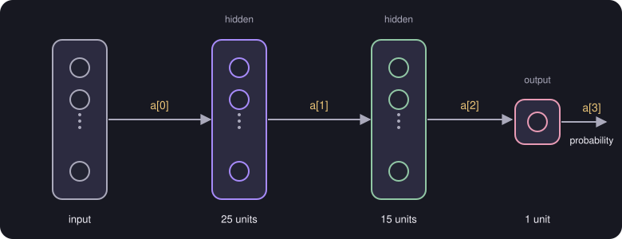

# Layer Computation (Intuition)

> **Source page:** 27 (top, "Intuition") · What each layer of a small network computes.

## 1. A network with 25, 15 and 1 units

The source draws a network with an input $\vec a^{[0]}$, a first layer of **25 units**, a second layer of **15 units** and a layer with **1 unit** (the hidden units are marked in the sketch). The last activation $\vec a^{[3]}$ is a **probability**.

*Figure: the activations $a^{[1]}$, $a^{[2]}$ and $a^{[3]}$ passed from layer to layer.*

## 2. What the first layer computes

Each unit applies $g$ to a weighted sum of the previous activations:

$$
\vec a^{[1]} =
\begin{bmatrix}
g\left(\vec w_1^{[1]}\cdot\vec a^{[0]} + b_1^{[1]}\right)\\
\vdots\\
g\left(\vec w_{25}^{[1]}\cdot\vec a^{[0]} + b_{25}^{[1]}\right)
\end{bmatrix}
$$

The second and third layers follow the same pattern with the sizes shown in the diagram (15 units, then 1 unit), each taking the previous layer's activations as its input.

> **Note on the source:** the index labels of the expressions for $\vec a^{[2]}$ and $\vec a^{[3]}$ are only partly legible on page 27 ([UNCLEAR IN SOURCE]). They are described here by pattern rather than copied symbol by symbol.

## Detailed Explanation

> **Additional Explanation:**  
> This explanation has been added to improve understanding and is not a direct transcription of the original handwritten notes.
>
> **Following the numbers through.** Suppose the input $\vec x$ has $n$ numbers.
>
> 1. **Layer 1 (25 units).** Each unit has its own weight vector of length $n$ and its own bias. Each produces one number. Together the 25 numbers form $\vec a^{[1]}$.
> 2. **Layer 2 (15 units).** Each unit now looks at the 25 numbers in $\vec a^{[1]}$, so each has 25 weights. The 15 results form $\vec a^{[2]}$.
> 3. **Layer 3 (1 unit).** It looks at the 15 numbers in $\vec a^{[2]}$ and gives a single number $a^{[3]}$ between 0 and 1.
>
> **Counting parameters.** Layer 1 has $25n + 25$, layer 2 has $25\times15 + 15 = 390$, and layer 3 has $15+1 = 16$. The total is $25n + 431$. For example, with $n=100$ inputs that is 2931 parameters.
>
> **Turning the output into a decision.** The final number is read as a probability. A common rule is to predict 1 if $a^{[3]}\ge 0.5$ and 0 otherwise.
>
> **Why the shapes must match.** The number of weights in each unit must equal the number of values coming in. If the shapes do not match, the dot product cannot be computed. When you get a shape error in code, check this first.
>
> **Common mistake.** Forgetting that every layer has a *separate* bias per unit, not one bias for the whole layer.

## 3. Related topics

- Previous: [Neural networks](01-neural-networks.md)
- Next: [Activation functions](03-activation-functions.md)
- Writing this layer as code: [Vectorization of a Dense layer](05-vectorization-dense-layer.md)