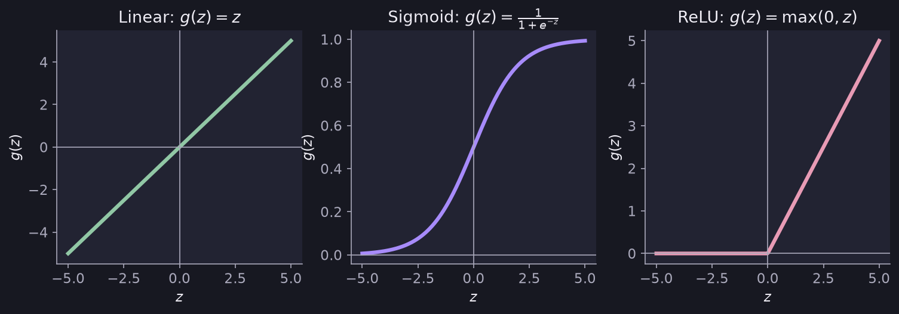

# Activation Functions

> **Source page:** 23 · The function $g(z)$ applied inside each neuron, and which one to choose.

## 1. The three main activation functions

| Function | Formula | Notes from the source | Used for |
|---|---|---|---|
| **Linear** | $g(z)=z$, with $z=\vec w\cdot\vec x+b$ | — | Regression ($y=\pm$) |
| **Sigmoid** | $g(z)=\dfrac{1}{1+e^{-z}}$ | $0<g(z)<1$ | Binary classification |
| **ReLU** (rectified linear unit) | $g(z)=\max(0,z)$ | $g(z)$ is $0$ if $z<0$, and $z$ if $z\ge 0$; **most common and faster** | Regression ($y=0$ or positive) |

*Figure: the three activation functions sketched on the source page.*

## 2. Choosing one

> **Note (from the source):** choose among these for the **output layer** based on the function (the kind of target). Use **ReLU by default for hidden layers.**

## 3. Other activation functions

- tanh activation function
- Leaky ReLU
- Swish function

## Detailed Explanation

> **Additional Explanation:**  
> This explanation has been added to improve understanding and is not a direct transcription of the original handwritten notes.
>
> **Why we need activation functions at all.** If every neuron used the linear function $g(z)=z$, then stacking layers would still give just one linear function in the end, because a linear function of a linear function is linear. A deep network would be no more powerful than plain linear regression. Non-linear activations (sigmoid, ReLU, ...) are what let a network learn curved patterns.
>
> **Choosing the output activation by the type of answer.**
>
> | What you predict | Output activation |
> |---|---|
> | Yes / no (probability) | Sigmoid |
> | A number that can be positive or negative | Linear |
> | A number that can only be zero or positive | ReLU |
>
> **Choosing the hidden activation.** The source says to use ReLU by default. One reason it is popular is that it is very cheap to compute. Another is that it is flat only on one side, so gradient descent usually learns faster than with the sigmoid, which is flat on both ends.
>
> **A few values to remember.**
>
> - Sigmoid: $g(0)=0.5$, $g(2)\approx 0.88$, $g(-2)\approx 0.12$.
> - ReLU: $g(-3)=0$, $g(2.5)=2.5$.
>
> **Common mistake.** Using a sigmoid on the output of a regression problem. A sigmoid can never go above 1, so it cannot predict a price of 300.

## 4. Related topics

- Previous: [Layer computation](02-layer-computation.md)
- Next: [Multiclass classification and softmax](04-multiclass-and-softmax.md)