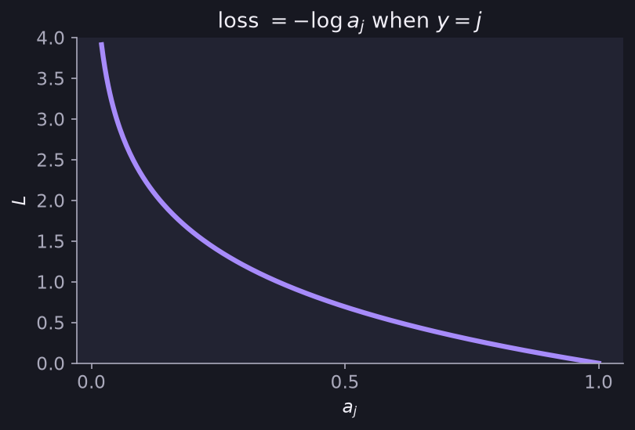

# Multiclass Classification and Softmax

> **Source pages:** 22 (multiclass and softmax), 25 (cost, sparse categorical cross-entropy) · Classification where the target $y$ can take more than two possible values.

## 1. Softmax regression algorithm

For $N$ possible outputs, compute a score for each class:

$$
z_j = \vec w_j\cdot\vec x + b_j\qquad [\,j=1,\dots,N\,]
$$

Then turn the scores into probabilities:

$$
a_j = \frac{e^{z_j}}{\sum_{k=1}^{N}e^{z_k}} = P(y=j\mid\vec x)
$$

> **Note (from the source):** $a_1+a_2+a_3+\dots+a_N = 1$.

## 2. Example with 4 possible outputs (1, 2, 3, 4)

$$
z_1 = \vec w_1\cdot\vec x + b_1,\quad
a_1 = \frac{e^{z_1}}{e^{z_1}+e^{z_2}+e^{z_3}+e^{z_4}} = P(y=1\mid\vec x)
$$

$$
z_2 = \vec w_2\cdot\vec x + b_2,\quad
a_2 = \frac{e^{z_2}}{e^{z_1}+e^{z_2}+e^{z_3}+e^{z_4}} = P(y=2\mid\vec x)
$$

and so on for classes 3 and 4. (In the source the classes are drawn as 1 – X, 2 – O, …)

## 3. Cost: sparse categorical cross-entropy

The page title is written as "Cost (Crossentropy loss)", with *Crossentropy loss* struck through and replaced by **Sparse Categorical Crossentropy**.

$$
\text{loss}(a_1,\dots,a_N,y) =
\begin{cases}
-\log a_1 & \text{if } y=1\\
-\log a_2 & \text{if } y=2\\
\ \vdots\\
-\log a_N & \text{if } y=N
\end{cases}
\quad\Longrightarrow\quad
\text{loss} = -\log a_j\ \text{ if } y=j
$$

*Figure: the loss $-\log a_j$ against $a_j$: it is large when the probability given to the true class is small and falls to 0 as $a_j\to 1$.*

> **Note on the source:** the page uses $n$ for the number of classes in the cost, and $N$ in the softmax formula. They refer to the same quantity.

## Detailed Explanation

> **Additional Explanation:**  
> This explanation has been added to improve understanding and is not a direct transcription of the original handwritten notes.
>
> **The idea.** With $N$ classes the network computes one score $z_j$ per class. Softmax turns these scores into $N$ probabilities that are all positive and add up to 1. The larger the score, the larger the probability.
>
> **Worked example (made-up scores).** Four classes with $z = [2,\ 1,\ 0,\ -1]$.
>
> | | $e^{z}$ | Probability $a_j$ |
> |---|---|---|
> | Class 1 | 7.389 | 0.644 |
> | Class 2 | 2.718 | 0.237 |
> | Class 3 | 1.000 | 0.087 |
> | Class 4 | 0.368 | 0.032 |
>
> The sum of the $e^{z}$ values is $11.475$, and the probabilities add up to $1$ as the source's note says.
>
> **The loss on this example.** If the true class is 1, the loss is $-\ln(0.644)\approx 0.44$ (small, good). If the true class is 4, the loss is $-\ln(0.032)\approx 3.44$ (large, bad). Only the probability given to the *true* class matters.
>
> **Why "sparse".** The label is stored as a single integer ($y=3$) rather than as a long list like $[0,0,1,0]$. TensorFlow's name for this form of the loss is *sparse* categorical cross-entropy.
>
> **Link to logistic regression.** With only two classes, softmax gives the same kind of answer as the sigmoid of logistic regression.
>
> **Common mistake.** Using sigmoid at the output for more than two classes. The outputs would not add up to 1.

## 4. Related topics

- Previous: [Activation functions](03-activation-functions.md)
- Binary version of the loss: [Logistic loss](../01-supervised-learning/07-logistic-loss-and-cost.md)