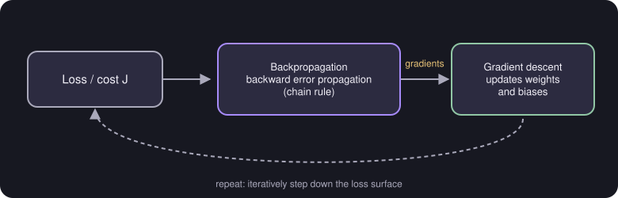

# Backpropagation versus Gradient Descent

> **Source pages:** 15 and 28 (identical pages) · A side-by-side comparison of the two ideas.

| Aspect | Back propagation | Gradient descent |
|---|---|---|
| **Purpose** | Compute gradient via the chain rule | Update parameters using gradients |
| **Scope** | Neural network specific | General optimization algorithm |
| **Process** | Backward error propagation | Iterative stepping down the loss surface |
| **Output** | Gradients for each parameter | Updates weights and biases |

*Figure: backpropagation produces the gradients; gradient descent uses them to update the parameters, and the cycle repeats.*

> **Note (from the source, p. 24):** "Backpropagation logic in notebook (jupyter)" — the detailed backpropagation work is kept in a separate notebook and is not part of these pages.

## Detailed Explanation

> **Additional Explanation:**  
> This explanation has been added to improve understanding and is not a direct transcription of the original handwritten notes.
>
> **Two different jobs.** People often treat these as the same thing, but they do different jobs:
>
> - *Backpropagation* answers: "**in which direction** and by how much does the cost change if I nudge each parameter?"
> - *Gradient descent* answers: "**given** those directions, what should the new parameters be?"
>
> **An analogy.** You are standing on a hillside in fog and want to reach the valley. Backpropagation is feeling the slope under your feet in every direction. Gradient descent is taking a step downhill. You repeat both many times.
>
> **Why the chain rule appears.** In a network the cost depends on the output, which depends on the last layer's $z$, which depends on the weights. To find how the cost depends on an early weight, you multiply the small effects along that chain:
>
> $$ \frac{\partial J}{\partial w} = \frac{\partial J}{\partial a}\cdot\frac{\partial a}{\partial z}\cdot\frac{\partial z}{\partial w} $$
>
> **Why "backward".** The network first runs **forward** to get the output and the loss. Then it works **backwards** from the loss, reusing the pieces already computed for later layers. This reuse makes it far cheaper than working out each derivative separately.
>
> **What you actually need to do.** Libraries such as TensorFlow do backpropagation for you inside `fit`. Knowing what it does helps you understand why training works and where it can go wrong.
>
> **Common mistake.** Saying "backpropagation updates the weights". It only *computes* the gradients; the optimiser (gradient descent or Adam) does the update.

## Related topics

- Previous: [TensorFlow and model training steps](06-tensorflow-and-training-steps.md)
- Next: [Adam algorithm and types of layers](08-adam-and-layer-types.md)
- Gradient descent itself: [Linear regression](../01-supervised-learning/01-linear-regression.md)