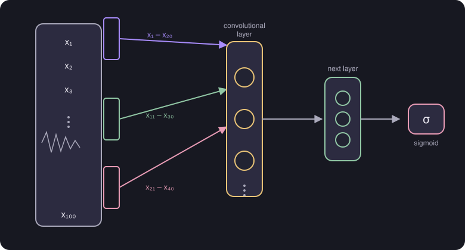

# Adam Algorithm and Types of Layers

> **Source page:** 24 · An optimiser that adapts the learning rate, and a layer type other than Dense.

## 1. Adam algorithm

**Adam** stands for **Ada**ptive **M**oment estimation. It is used to increase or decrease the learning rate $\alpha$ to optimize gradient descent.

## 2. Types of layers

- **Dense** layer — "we already used".
- **Convolutional layer** — each neuron looks at only part of the input.

**Example (from the source): ECG graph analysis.** The input signal is $x_1,\dots,x_{100}$.

- The first convolutional neuron looks at $x_1$–$x_{20}$.
- The next at $x_{11}$–$x_{30}$.
- The next at $x_{21}$–$x_{40}$, and so on.
- The activations then feed a further layer and finally a **sigmoid** output unit.

*Figure: each neuron of the convolutional layer sees only a window of the input; windows overlap.*

> **Note on the source:** the sketch labels a group of activations "a₁–a₅" and shows a small layer of three units before the sigmoid; the exact layer sizes are not stated in words.

## Detailed Explanation

> **Additional Explanation:**  
> This explanation has been added to improve understanding and is not a direct transcription of the original handwritten notes.
>
> **What Adam fixes.** With plain gradient descent you must choose one $\alpha$ for every parameter and keep it fixed. If it is too small, training is slow. If it is too large, training bounces around. Adam adjusts the step size automatically: if a parameter keeps moving in the same direction, its steps get bigger; if it keeps jumping back and forth, they get smaller. You still give it a starting $\alpha$, but it is less sensitive to the choice.
>
> **Why convolutional layers.** A Dense layer connects every neuron to every input. For an ECG with 100 values, that means 100 weights per neuron. A convolutional neuron looks at only a small window (20 values in the source), so it has fewer weights.
>
> **Counting the windows.** The source's windows are $x_1$–$x_{20}$, $x_{11}$–$x_{30}$, $x_{21}$–$x_{40}$: each window starts 10 values after the last one. With 100 inputs, windows of 20 and a shift of 10 there would be $(100-20)/10+1 = 9$ windows.
>
> **Benefits.**
>
> - Fewer parameters, so training is faster and the model overfits less.
> - Each neuron focuses on a local part of the signal, such as one heartbeat shape.
> - Different neurons can look at different parts of the signal.
>
> **Common mistake.** Thinking Adam replaces gradient descent. It is a smarter version of it and still needs the gradients from backpropagation.

## 3. Related topics

- Previous: [Backpropagation versus gradient descent](07-backpropagation-vs-gradient-descent.md)
- Learning-rate choice without Adam: [Gradient descent in practice](../01-supervised-learning/04-gradient-descent-in-practice.md)