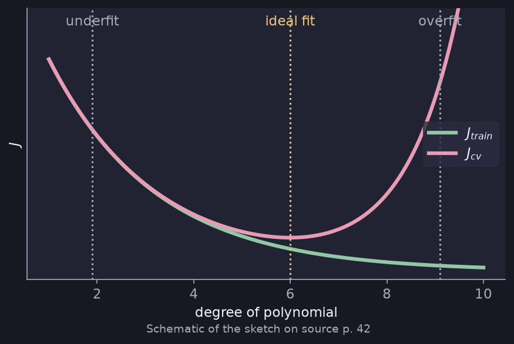
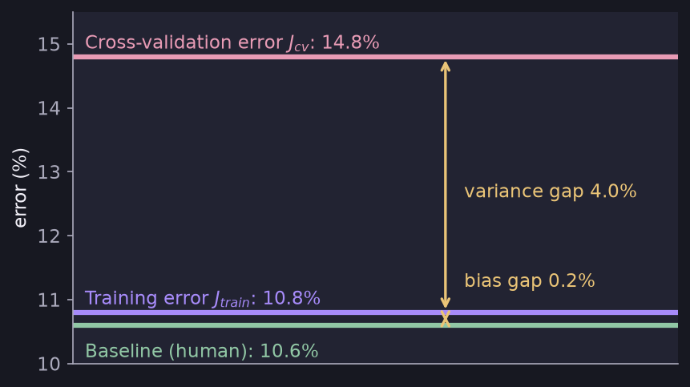
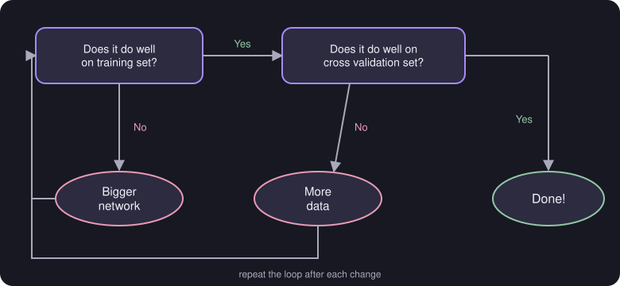

# Bias and Variance

> **Source pages:** 42 (diagnostics), 47 (trade-off for neural networks) · Telling whether a model underfits or overfits, and what to do about it.

## 1. Diagnostics

- **High bias → underfit.**
- **High variance → overfit.**

Plot $J_{train}$ and $J_{cv}$ against the degree of the polynomial: $J_{train}$ keeps falling, while $J_{cv}$ falls and then rises. The lowest point of $J_{cv}$ is the *ideal fit*.

*Figure: underfit on the left, ideal fit at the minimum of $J_{cv}$, overfit on the right (schematic redrawing of the source sketch).*

> **Note (from the source):** using this we can also get the ideal value of $\lambda$ (the regularization constant).

## 2. Example: speech recognition model

| Quantity | Error |
|---|---|
| Baseline performance (human) | 10.6 % |
| Training error ($J_{train}$) | 10.8 % |
| Cross-validation error ($J_{cv}$) | 14.8 % |

- The gap between baseline and training error is **0.2 %** — labelled **Bias** in the source.
- The gap between training and cross-validation error is **4.0 %** — labelled **Variance** in the source.

*Figure: the two gaps of the example above.*

## 3. Bias/variance trade-off for neural networks *(marked "Imp")*

**Large neural networks are low bias machines.** The source gives a workflow:

*Figure: if the network does not do well on the training set, use a bigger network; if it does well on the training set but not on the cross-validation set, get more data; otherwise, done.*

## 4. ML diagnostics priority

1. Bias/variance trade-off.
2. Error analysis ("coming up" — see [ML development and error analysis](06-ml-development-and-error-analysis.md)).

## Detailed Explanation

> **Additional Explanation:**  
> This explanation has been added to improve understanding and is not a direct transcription of the original handwritten notes.
>
> **A simple way to diagnose.** Compare three numbers: the baseline (what a human or a good benchmark achieves), the training error and the cross-validation error.
>
> | What you see | Diagnosis |
> |---|---|
> | Training error far above baseline | High bias (underfitting) |
> | CV error far above training error | High variance (overfitting) |
> | Both gaps large | Both problems |
> | Both gaps small | Good |
>
> **Applying it to the speech example.** Baseline $10.6\%$, training $10.8\%$, CV $14.8\%$.
>
> - Bias gap: $10.8-10.6 = 0.2\%$, which is tiny, so the model fits the training data about as well as a human could.
> - Variance gap: $14.8-10.8 = 4.0\%$, which is large. The model does much worse on data it has not seen, so the main problem is **variance**.
>
> **Why the baseline matters.** A training error of $10.8\%$ sounds high by itself. It only looks bad or good when compared with what is achievable, here $10.6\%$.
>
> **How $\lambda$ fits in.** A very large $\lambda$ forces simple models (high bias). A very small $\lambda$ allows complex ones (high variance). The $\lambda$ with the lowest $J_{cv}$ is a good choice.
>
> **The neural-network recipe.** The source's flowchart gives a loop: if the network does not do well on the training set, make it bigger; if it does well on training but not on the CV set, get more data. Repeat until both are good. This works because a large network (with regularization if needed) can usually fit the training data well, and more data then cures the variance.
>
> **Common mistake.** Collecting more data when the real problem is high bias. More data does not help a model that is too simple.

## 5. Related topics

- Previous: [Model selection](02-model-selection.md)
- Next: [Learning curves and debugging](04-learning-curves-and-debugging.md)
- Overfitting basics: [Overfitting](../01-supervised-learning/08-overfitting.md)