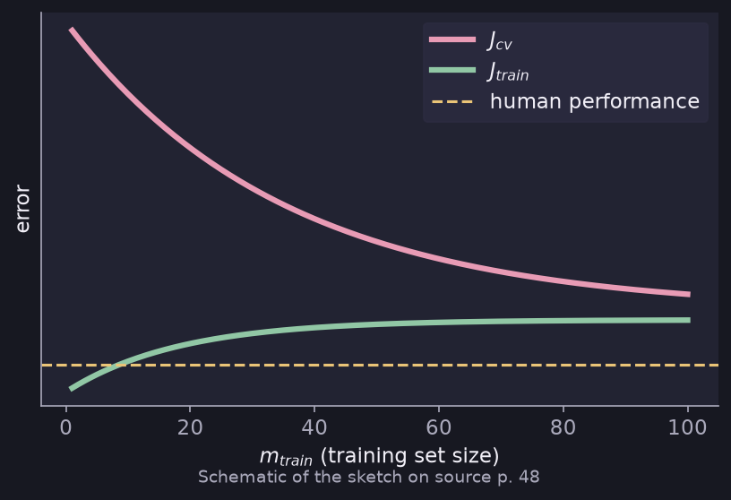

# Learning Curves and Debugging a Learning Algorithm

> **Source page:** 48 · Using a plot of error against training-set size, and a checklist for fixing bias and variance.

## 1. Learning curve *(marked "Imp")*

Plot the errors $J_{cv}$ and $J_{train}$ against $m_{train}$ (the training-set size), together with the *human performance* level.

*Figure: $J_{cv}$ falls and $J_{train}$ rises with more data and they approach each other (schematic redrawing).*

Plotting the curve will help give an idea whether the model has high bias or high variance.

## 2. Debugging a learning algorithm

| Fixing high variance | Fixing high bias |
|---|---|
| Get more training examples | Try getting additional features |
| Try smaller sets of features ($x, x^2, \dots$) | Try adding polynomial features |
| Try increasing $\lambda$ | Try decreasing $\lambda$ |

> **Note on the source:** in the high-bias column the word "increasing" is crossed out and replaced by "decreasing". In the "smaller sets of features" item some of the listed powers ($x^3, x^4,\dots$) are crossed out; only $x, x^2$ are clearly retained.

## Detailed Explanation

> **Additional Explanation:**  
> This explanation has been added to improve understanding and is not a direct transcription of the original handwritten notes.
>
> **What a learning curve shows.** Train on 10 examples, then 20, then 30, and so on, and record $J_{train}$ and $J_{cv}$ each time. Plotting them against the training-set size shows how the model behaves as it gets more data.
>
> **Why the two curves move as they do.**
>
> - $J_{train}$ **goes up** with more data. With only a few examples a model can fit them all perfectly; with many it can't.
> - $J_{cv}$ **goes down** with more data, because the model learns more of the real pattern.
>
> **What the curve tells you.**
>
> - *High bias:* both curves flatten out at a high error, close to each other. More data will not help, because the model is too simple.
> - *High variance:* there is a big gap between a low $J_{train}$ and a higher $J_{cv}$. More data usually helps close the gap.
>
> **Why each fix in the table works.**
>
> | Fix | Why |
> |---|---|
> | More training examples | Harder to memorise, so less variance |
> | Smaller set of features | Simpler model, less variance |
> | Increase $\lambda$ | Smaller weights, simpler model, less variance |
> | Additional features | More flexible model, less bias |
> | Polynomial features | Can fit curves, less bias |
> | Decrease $\lambda$ | Less penalty, more flexible, less bias |
>
> **Common mistake.** Trying a fix without first diagnosing. Adding features to a model that is overfitting makes it worse.

## 3. Related topics

- Previous: [Bias and variance](03-bias-and-variance.md)
- Next: [Data-centric improvements](05-data-centric-improvements.md)
- Regularization parameter: [Regularization](../01-supervised-learning/09-regularization.md)