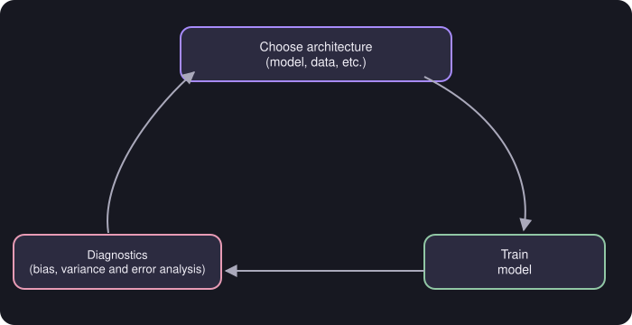
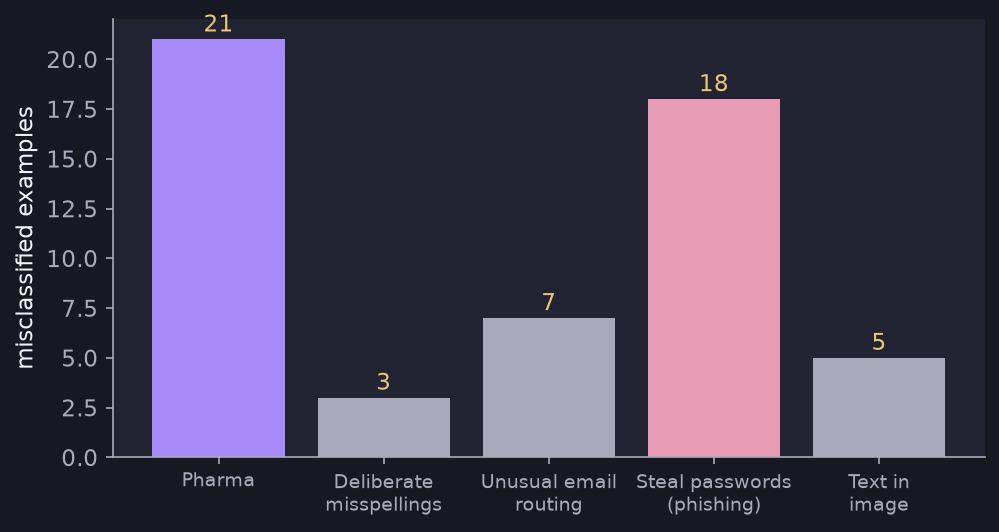

# ML Development and Error Analysis

> **Source page:** 50 · The iterative loop of building a model, and a manual way to find what to fix.

## 1. Iterative loop

Choose architecture (model, data, etc.) → train model → diagnostics (bias, variance and error analysis) → repeat.

*Figure: the loop is repeated until the model is good enough.*

## 2. Error analysis

**Manually examine 100 examples and categorize them based on common traits.**

**Example (from the source): spam email classifier.**

| Category | Count |
|---|---|
| Pharma | 21 |
| Deliberate misspellings (e.g. "w4tches") | 3 |
| Unusual email routing | 7 |
| Steal passwords (phishing) | 18 |
| Text in image | 5 |

*Figure: the counts from the table above, drawn as bars.*

The source concludes: *"∴ We can observe phishing to be a bigger problem."*

> **Note on the source:** in the counts above, **Pharma (21)** is larger than **phishing (18)**, yet the conclusion names phishing. This is preserved as written; it may be a slip or may refer to something not recorded on the page. The counts add up to 54, so not every examined example is placed in exactly one listed category.

## Detailed Explanation

> **Additional Explanation:**  
> This explanation has been added to improve understanding and is not a direct transcription of the original handwritten notes.
>
> **Development is a loop.** You rarely get a good model on the first try. You choose a design, train it, look at what goes wrong, and use that to choose the next design. Diagnostics such as [bias and variance](03-bias-and-variance.md) and error analysis tell you what to change.
>
> **What error analysis does.** It helps you decide where to spend your effort. Look at the examples the model got wrong, group them by type, and count.
>
> **Reading the spam example.** Shares of the 54 tagged mistakes:
>
> | Category | Count | Share |
> |---|---|---|
> | Pharma | 21 | about 39% |
> | Phishing (steal passwords) | 18 | about 33% |
> | Unusual email routing | 7 | about 13% |
> | Text in image | 5 | about 9% |
> | Deliberate misspellings | 3 | about 6% |
>
> Fixing a rare category (3 cases) can improve things by at most a little. Fixing a large one can remove a big part of the errors. The two biggest categories here, pharma and phishing, deserve the attention.
>
> **Note on the counts.** The categories do not need to add up to the number of examples checked: an example might fit no listed category, or more than one.
>
> **A practical limit.** Manually checking about 100 examples is feasible. For very large error sets, sample 100 or so of them.
>
> **Common mistake.** Spending weeks on a problem that causes only 3% of the errors.

## 3. Related topics

- Previous: [Data-centric improvements](05-data-centric-improvements.md)
- Next: [Precision, recall and F1](07-precision-recall-f1.md)
- Diagnostics: [Bias and variance](03-bias-and-variance.md)