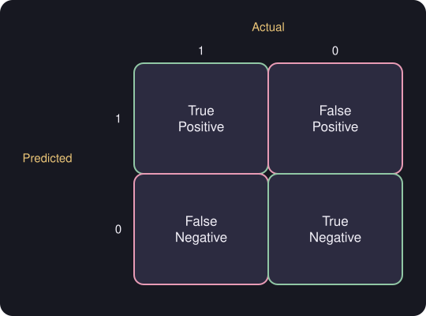

# Precision, Recall and the F1 Score

> **Source pages:** 43 (bottom, confusion matrix), 46 (precision, recall, F1) · Evaluation metrics for skewed classes.

## 1. Confusion matrix

Rows are the **predicted** class, columns the **actual** class.

*Figure: true positive, false positive, false negative and true negative.*

> **Note on the source:** page 43 also has a crossed-out heading "Precision" and scribbled-out first attempts at the definitions; they are illegible and are not transcribed. The final definitions are on page 46.

## 2. Precision and recall

$$
\text{Precision} = \frac{\text{True positives}}{\text{predicted positives}} = \frac{\text{True positives}}{\text{True pos.} + \text{False pos.}}
$$

$$
\text{Recall} = \frac{\text{True positives}}{\text{actual positives}} = \frac{\text{True positives}}{\text{True pos.} + \text{False neg.}}
$$

## 3. Trade-off

| We want to… | Result |
|---|---|
| avoid missing too many cases | **low** precision, **high** recall |
| predict only with certainty | **high** precision, **low** recall |

> **Note on the source:** in the first row the words "high precision / low recall" are crossed out and replaced by "low precision / high recall"; the corrected version is given above.

## 4. F1 score

A way to combine precision and recall to decide which algorithm to use.

$$
F_1 = \frac{1}{\dfrac{1}{2}\left(\dfrac{1}{P}+\dfrac{1}{R}\right)} = 2\,\frac{PR}{P+R}
$$

## Detailed Explanation

> **Additional Explanation:**  
> This explanation has been added to improve understanding and is not a direct transcription of the original handwritten notes.
>
> **Why accuracy is not enough.** Imagine a disease that only 1 in 100 people has. A "model" that always says *healthy* is right 99% of the time, yet it finds nobody who is ill. Precision and recall look at the positive class directly.
>
> **Plain-language meaning.**
>
> - **Precision:** of all the cases the model *called* positive, how many really were? (How trustworthy is a positive prediction?)
> - **Recall:** of all the cases that really *are* positive, how many did the model find? (How few did it miss?)
>
> **Worked example (made-up).** Out of 100 cases: TP = 8, FP = 2, FN = 4, TN = 86.
>
> - Precision $= 8/(8+2) = 0.80$
> - Recall $= 8/(8+4) \approx 0.67$
> - $F_1 = 2\cdot 0.80\cdot 0.67 / (0.80+0.67) \approx 0.73$
>
> **The trade-off.** If you only flag a case when you are very sure, precision goes up (few false alarms) but recall goes down (you miss cases). If you flag anything suspicious, recall goes up but precision goes down. Which to prefer depends on the cost of each kind of mistake.
>
> **Why $F_1$ uses the harmonic mean.** The ordinary average of $P=0.5$ and $R=0.02$ would be $0.26$, which looks acceptable. The $F_1$ value is $2(0.5)(0.02)/0.52 \approx 0.04$, which correctly shows that the model is poor. $F_1$ is low unless *both* precision and recall are reasonably high.
>
> **Common mistake.** Swapping the rows and columns of the confusion matrix. In the source, rows are *predicted* and columns are *actual*.

## 5. Related topics

- Previous: [ML development and error analysis](06-ml-development-and-error-analysis.md)
- Metrics for anomaly detection: [Evaluating anomaly detection](../05-unsupervised-learning/06-evaluating-anomaly-detection.md)