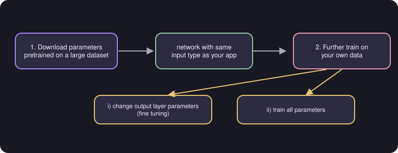

# Transfer Learning

> **Source page:** 44 (top) · Re-using a network trained for a different task.

Transfer learning means using data (the source writes "data meant for a different task") in your model by modifying it. There are two options:

1. **Change the output layer parameters** (fine tuning).
2. **Train all parameters.**

## Summary (from the source)

1. Download neural network parameters pretrained on a large dataset with the same input type as your application.
2. Further train the network on your own data.

*Figure: the two steps of the summary and the two training options.*

## Detailed Explanation

> **Additional Explanation:**  
> This explanation has been added to improve understanding and is not a direct transcription of the original handwritten notes.
>
> **The idea.** Training a large network from scratch needs a lot of data and time. Someone may already have trained a network on a huge dataset. Its early layers have learned general things (in images: edges, corners, simple shapes) that are useful for many tasks. You reuse them and only adapt the rest.
>
> **The two options in the source.**
>
> 1. **Change only the output layer** (fine tuning in the source's words): keep the downloaded parameters for all earlier layers and train just the output layer. This suits a **small** dataset, because only a few parameters must be learned.
> 2. **Train all parameters**: start from the downloaded values and let every layer adjust. This suits a **larger** dataset, and usually gives better results if you have the data.
>
> **A rule you must respect.** The input type must be the same: a network pretrained on images can help another image task, but not an audio task.
>
> **Why it works even for a different task.** If the original network learned to recognise cats and dogs, its early layers can also help recognise, say, handwritten digits, because both need to detect strokes and shapes.
>
> **Common mistake.** Changing the input size or type so that it no longer matches the pretrained network.

## Related topics

- Previous: [Precision, recall and F1](07-precision-recall-f1.md)
- Next: [ML project cycle and deployment](09-ml-project-cycle-and-deployment.md)
- Neural networks: [Neural networks](../02-advanced-learning-algorithms/01-neural-networks.md)