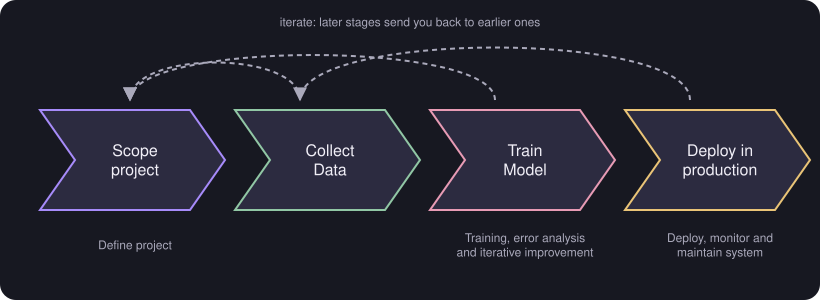
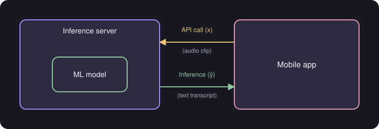

# ML Project Cycle and Deployment

> **Source pages:** 44 (bottom, cycle of an ML project), 43 (top, deployment) · From defining a project to running it in production.

## 1. Cycle of an ML project

| Stage | Description in the source |
|---|---|
| **Scope project** | Define project |
| **Collect data** | — |
| **Train model** | Training, error analysis and iterative improvement |
| **Deploy in production** | Deploy, monitor and maintain system |

*Figure: the four stages, with arrows leading back to earlier stages.*

## 2. Deployment

A mobile app sends an **API call** containing the input $x$ (an audio clip) to an **inference server** that holds the ML model. The server returns the **inference** $\hat y$ (a text transcript).

*Figure: the speech-recognition deployment example from the source.*

> **Note (from the source):** MLOps for deploying large scale models.

## Detailed Explanation

> **Additional Explanation:**  
> This explanation has been added to improve understanding and is not a direct transcription of the original handwritten notes.
>
> **The four stages in plain words.**
>
> 1. **Scope:** decide what the project is for and what a good result means.
> 2. **Collect data:** gather and label the examples.
> 3. **Train model:** train, run error analysis and improve step by step. You may go back to collect more data.
> 4. **Deploy:** put the model into real use, watch how it behaves and keep it working.
>
> **Why the arrows go back.** Things you learn late (for example, that the model is weak on a type of audio) send you back to earlier stages (collect more of that audio). Real projects loop.
>
> **What deployment looks like.** In the source's example, the phone app records an audio clip $x$ and sends it over the internet (an *API call*) to a server. The server runs the model and sends back the text $\hat y$. The model stays on the server, so it can be updated without changing the app.
>
> **Why monitoring matters.** After release, the real data can change (new accents, new words). Watching the model's performance lets you notice and retrain.
>
> **What MLOps is.** The source's note says *MLOps* is for deploying large-scale models. It is the set of practices for deploying, monitoring and updating models reliably.
>
> **Common mistake.** Treating deployment as the end. The model needs care afterwards.

## 3. Related topics

- Previous: [Transfer learning](08-transfer-learning.md)
- The development loop inside "Train model": [ML development and error analysis](06-ml-development-and-error-analysis.md)