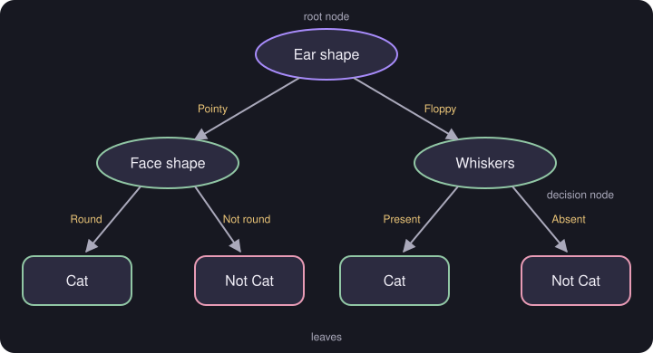

# Decision Trees

> **Source page:** 45 · A tree of yes/no questions that classifies an example.

## 1. Example: cat classification

*Figure: the source's tree. The first split is on **Ear shape** (the root node); decision nodes test **Face shape** and **Whiskers**; the leaves give Cat / Not Cat.*

Terms from the source: **root node**, **decision node**, **leaves**.

## 2. The two decisions in building a tree

**Decision 1:** choosing a feature to split on at a node (see [Entropy](02-entropy.md) and [Information gain](03-information-gain.md)).

**Decision 2:** when do you stop splitting?

- The node is 100 % one class.
- The tree exceeds the maximum depth.
- Improvements in purity are below a threshold.
- The number of examples in a node is below a threshold.

## Detailed Explanation

> **Additional Explanation:**  
> This explanation has been added to improve understanding and is not a direct transcription of the original handwritten notes.
>
> **How a tree makes a prediction.** Start at the top (the root). At each decision node, check one feature and follow the matching branch. Keep going until you reach a leaf, which holds the answer. In the cat example: *pointy ears* → check *face shape* → *round* → **Cat**.
>
> **The two decisions and why they matter.**
>
> - *Decision 1 (which feature to split on):* a good split gives branches that are as pure as possible (mostly one class). We measure this with [entropy](02-entropy.md) and [information gain](03-information-gain.md).
> - *Decision 2 (when to stop):* if you keep splitting until every leaf is perfectly pure, the tree can memorise the training data and overfit. The stopping rules in the source all prevent a tree from becoming too large or too specific.
>
> **The four stopping rules, in plain words.**
>
> | Rule | Why |
> |---|---|
> | Node is 100% one class | Nothing left to separate |
> | Tree reaches the maximum depth | Keeps the tree small and easier to read |
> | Purity gain is below a threshold | The split adds almost nothing |
> | Too few examples in the node | A split on a handful of examples is unreliable |
>
> **Why people like trees.** A small tree can be read and explained, as the source notes (see [Trees vs neural networks](08-trees-vs-neural-networks.md)).
>
> **Common mistake.** Letting the tree grow until every leaf is pure. It then fits noise.

## 3. Related topics

- Next: [Entropy as a measure of impurity](02-entropy.md)
- Ensembles of trees: [Random forest](06-random-forest.md), [XGBoost](07-xgboost.md)