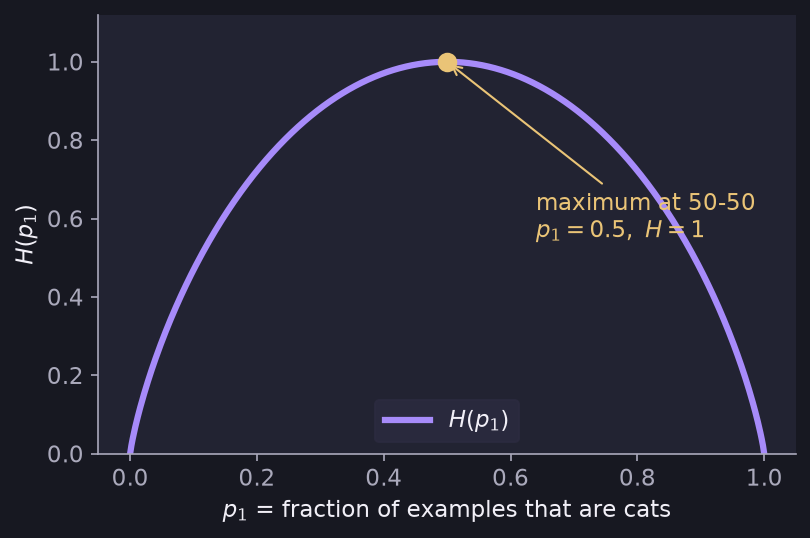

# Entropy as a Measure of Impurity

> **Source page:** 1 · A number that says how mixed a node is.

## 1. Definitions

- $p_1$ = fraction of examples that are cats.
- $p_0$ = fraction of not-cats, so $p_0 = 1 - p_1$.

The entropy is written $H(p)$; for this example $H(p_1)$.

## 2. Formula

$$
H(p_1) = -p_1\log_2(p_1) - p_0\log_2(p_0)
$$

$$
\phantom{H(p_1)} = -p_1\log_2(p_1) - (1-p_1)\log_2(1-p_1)
$$

By convention, take $0\log(0) = 0$.

## 3. Shape of the curve

> **Note (from the source):** entropy is at its maximum when both classes are 50-50. "Take entropy as unbalance" (the source's wording: the more mixed the node, the higher the entropy).

*Figure: $H(p_1)$ is 0 when the node is pure ($p_1=0$ or $1$) and peaks at $p_1=0.5$.*

> **Note on the source:** the hand-drawn curve peaks a little below 1 on its axis; the true maximum of $H(p_1)$ is exactly 1 at $p_1=0.5$.

## 4. Information gain

> **Note (from the source):** the **reduction in entropy** is called **information gain**.

## Detailed Explanation

> **Additional Explanation:**  
> This explanation has been added to improve understanding and is not a direct transcription of the original handwritten notes.
>
> **What impurity means.** A node with 5 cats and 5 dogs is as mixed as it can be (very impure). A node with 10 cats and 0 dogs is pure. Entropy gives each case a number: 0 for pure, up to 1 for the most mixed.
>
> **Worked values** (using $\log_2$):
>
> | $p_1$ | Meaning | $H(p_1)$ |
> |---|---|---|
> | 0 or 1 | Pure | 0 |
> | $1/3$ | 1 cat in 3 | 0.918 |
> | 0.2 or 0.8 | Mostly one class | 0.722 |
> | 0.5 | Perfectly mixed | 1 |
>
> For example, $H(0.5) = -0.5\log_2 0.5 - 0.5\log_2 0.5 = 0.5 + 0.5 = 1$.
>
> **Why use $\log_2$.** Using base 2 makes the maximum value exactly 1, which is neat.
>
> **Why take $0\log 0 = 0$.** $\log 0$ is not defined. But when $p$ is very small, $p\log p$ gets closer and closer to 0, so defining it as 0 is the sensible choice. It lets the formula work for pure nodes.
>
> **The shape of the curve.** It is a hill: zero at both ends and highest in the middle. Entropy does not care which class is the majority; $p_1=0.2$ and $p_1=0.8$ are equally mixed.
>
> **Common mistake.** Reading entropy as "probability of a cat". It measures how mixed the node is, not which class dominates.

## 5. Related topics

- Previous: [Decision trees](01-decision-trees.md)
- Next: [Information gain](03-information-gain.md)