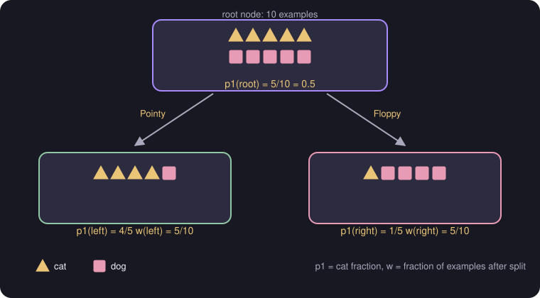

# Information Gain

> **Source page:** 13 · Using entropy to choose which feature to split on.

## 1. Example

Triangles are **cats**, squares are **dogs**; the goal is to identify cats. Splitting on **Ear shape** (pointy / floppy):

*Figure: the root has 5 cats out of 10; the pointy branch has 4 cats out of 5; the floppy branch has 1 cat out of 5.*

| Node | $p_1$ (cat fraction) | $w$ (fraction of examples after split) |
|---|---|---|
| Root | $p_1^{root} = 5/10 = 0.5$ | — |
| Left (pointy) | $p_1^{left} = 4/5$ | $w^{left} = 5/10$ |
| Right (floppy) | $p_1^{right} = 1/5$ | $w^{right} = 5/10$ |

## 2. Formula

$$
\text{Information gain} = H\left(p_1^{root}\right) - \left(w^{left}\,H\left(p_1^{left}\right) + w^{right}\,H\left(p_1^{right}\right)\right)
$$

> **Additional Explanation:**  
> This explanation has been added to improve understanding and is not a direct transcription of the original handwritten notes.  
> The source stops at the formula. Evaluating it with the numbers above: $H(0.5)=1$ and $H(0.8)=H(0.2)\approx 0.72$, so the gain is $1 - (0.5\times0.72 + 0.5\times0.72) \approx 0.28$.

## 3. Recursive splitting

> **Note (from the source):** decision trees are built by **recursive splitting**, i.e. calculating the information gain for splitting the root node and then doing the same on each node that is formed.

## Detailed Explanation

> **Additional Explanation:**  
> This explanation has been added to improve understanding and is not a direct transcription of the original handwritten notes.
>
> **The goal.** Pick the feature whose split makes the two branches as pure as possible. Information gain measures that: how much did entropy drop?
>
> **Why the branches are weighted.** A branch with 9 of the 10 examples matters much more than one with 1 example. So each branch's entropy is multiplied by $w$, the fraction of examples that went to it. In the source's example both branches have $w=5/10$.
>
> **Checking the ear-shape example.**
>
> - Root: $H(0.5) = 1$.
> - Left: $H(0.8)\approx 0.722$. Right: $H(0.2)\approx 0.722$.
> - Weighted average after the split: $0.5(0.722)+0.5(0.722) = 0.722$.
> - Gain: $1 - 0.722 \approx 0.28$.
>
> **Comparing with another feature (hypothetical).** Suppose splitting on *face shape* gave a left branch of 7 examples with 4 cats and a right branch of 3 with 1 cat. Then $H(4/7)\approx 0.985$, $H(1/3)\approx 0.918$, the weighted entropy is $0.7(0.985)+0.3(0.918)\approx 0.965$, and the gain is $\approx 0.03$. Ear shape (0.28) wins clearly, so it is chosen for the root.
>
> **Recursive splitting.** After the root is split, you repeat the same steps inside each branch on the examples that landed there, until a stopping rule from [Decision trees](01-decision-trees.md) applies.
>
> **Common mistake.** Forgetting the weights $w$ and averaging the two branch entropies equally.

## 4. Related topics

- Previous: [Entropy](02-entropy.md)
- Next: [One-hot encoding](04-one-hot-encoding.md)