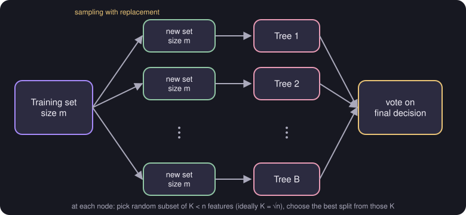

# Sampling with Replacement and the Random Forest Algorithm

> **Source page:** 10 · Building many trees on resampled data and letting them vote *(marked "imp" in the source)*.

## 1. Sampling with replacement

Pick a random training example out of the training set and plug it into the decision tree. **Put it back in the set** and pick a random example again. (It can repeat.)

## 2. Random forest algorithm

```text
Given a training set of size m
For b = 1 to B:
    Use sampling with replacement to create a new training set of size m.
    Train a decision tree on the new dataset.
```

Many decision trees are formed, and then they **vote on the final decision**.



*Figure: the training set is resampled with replacement for each of the $B$ trees; the trees then vote.*

> **Note on the source:** the loop limit is handwritten as "B" (it could be misread as "8" or "R").

## 3. Randomizing the feature choice

While doing this, the feature at the root node rarely changes. So, at each node, when choosing a feature to split on, if $n$ features are available:

- pick a random subset of $K < n$ features, and
- pick only from those $K$ the feature with the highest information gain.

Ideally $K$ is picked of size

$$
K = \sqrt{n}
$$

## Detailed Explanation

> **Additional Explanation:**  
> This explanation has been added to improve understanding and is not a direct transcription of the original handwritten notes.
>
> **The idea.** A single decision tree can change a lot if the training data changes a little (high variance). A random forest builds many different trees and lets them vote. Mistakes of individual trees tend to cancel out.
>
> **How each tree gets different data.** With sampling with replacement, each new training set has size $m$, but some examples appear twice or more and others not at all. Each draw misses a particular example with probability $1-\frac{1}{m}$, so for large $m$ about $1/e\approx 37\%$ of the original examples are left out of any one new set, and about $63\%$ appear at least once. So every tree sees a slightly different version of the data.
>
> **Why randomise the features too.** Without it, strong features would win at the top of almost every tree, so the trees would look alike and voting would add little. Letting each node choose from only a random $K<n$ features makes the trees more different.
>
> **Choosing $K$.** The source's rule is $K=\sqrt{n}$. For $n=100$ features that gives $K=10$ candidates at each node.
>
> **Making the final prediction.** For classification, each tree votes and the majority class wins.
>
> **Trade-offs.** More trees usually do not hurt accuracy but take longer to train and use. A forest is also harder to read than one small tree.
>
> **Common mistake.** Forgetting to put the example back after picking it. Without replacement, each new set would just be a copy of the original.

## 4. Related topics

- Previous: [Regression trees](05-regression-trees.md)
- Next: [XGBoost](07-xgboost.md)
- Building blocks: [Decision trees](01-decision-trees.md), [Information gain](03-information-gain.md)