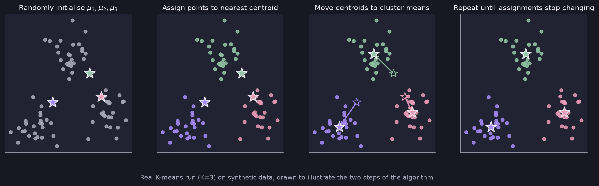

# Clustering and K-Means

> **Source page:** 11 · The start of *Course 3: Unsupervised Learning, Recommenders, Reinforcement Learning*.

## 1. Clustering

The target variable $y$ is unknown, therefore the data is grouped into classes by analysis. The most common clustering algorithm is **K-means**.

## 2. K-means intuition

1. Assign points as cluster centroids.
2. Move these cluster centroids to the **mean of the cluster points**.

(The source crosses out the words "fit better" in step 2.)

## 3. K-means algorithm *(marked "Imp")*

```text
Randomly initialize K cluster centroids  mu_1, mu_2, ..., mu_K
Repeat {
    # Assign points to cluster centroids
    for i = 1 to m
        c(i) := index (1 to K) of cluster centroid closest to x(i)
    # Move the cluster centroids
    for k = 1 to K
        mu_k := average (mean) of points assigned to cluster k
}
```

The "closest" centroid is the one that minimises the squared distance:

$$
c^{(i)} = \arg\min_{k}\left\lVert x^{(i)}-\mu_k\right\rVert^2
$$



*Figure: random initialisation, assignment to the nearest centroid, moving the centroids to the cluster means, and repeating until the assignments stop changing (real run on synthetic data).*

## Detailed Explanation

> **Additional Explanation:**  
> This explanation has been added to improve understanding and is not a direct transcription of the original handwritten notes.
>
> **Supervised versus unsupervised.** In supervised learning every example comes with a correct answer $y$. In clustering there are no answers. The algorithm looks at the points and groups those that are close to each other, for example customers with similar behaviour.
>
> **K-means in two repeating steps.** Think of $K$ "centres" (centroids) that move until they settle in the middle of groups.
>
> 1. *Assign:* every point joins the nearest centroid.
> 2. *Move:* every centroid moves to the average position of the points that joined it.
>
> **Worked example in one dimension.** Points: $1, 2, 3, 10, 11, 12$ with $K=2$ and starting centroids $\mu_1=1$, $\mu_2=12$.
>
> - *Assign:* $1,2,3$ are closest to $\mu_1$; $10,11,12$ are closest to $\mu_2$.
> - *Move:* $\mu_1 = (1+2+3)/3 = 2$ and $\mu_2=(10+11+12)/3=11$.
> - *Assign again:* nothing changes, so the algorithm has finished.
>
> **Why "closest" uses the squared distance.** Minimising $\lVert x^{(i)}-\mu_k\rVert^2$ gives the same winner as minimising the plain distance, and it is simpler to compute and to write.
>
> **When to stop.** When the assignments no longer change (or change very little), the centroids stop moving.
>
> **An edge case.** A centroid can end up with no points. Then its mean is undefined. A common choice is to drop that cluster (so $K$ becomes smaller) or to start that centroid again at a random place.
>
> **Common mistake.** Thinking the result is always the same. The starting positions matter (see [K-means cost and initialization](02-k-means-cost-and-initialization.md)).

## 4. Related topics

- Next: [K-means cost and initialization](02-k-means-cost-and-initialization.md)