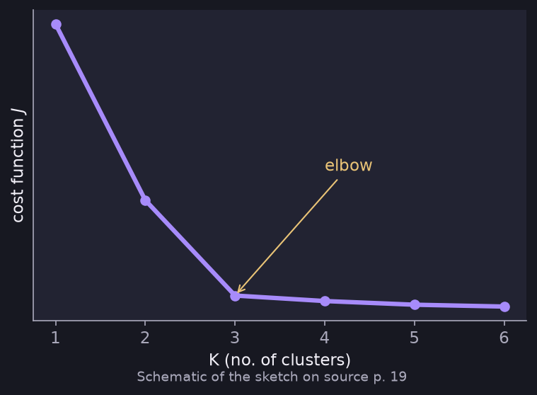

# Choosing the Value of K (Elbow Method)

> **Source page:** 19

Plot the cost function $J$ against $K$ (the number of clusters). The cost drops quickly at first and then flattens; the bend is the **elbow**.

*Figure: schematic redrawing of the source sketch; the elbow is at $K=3$.*

- Don't choose $K$ just to minimise the cost. Many clusters will always result in a low cost, so this is not efficient.
- **If there is no elbow structure, the number of clusters depends on the use case.**

## Detailed Explanation

> **Additional Explanation:**  
> This explanation has been added to improve understanding and is not a direct transcription of the original handwritten notes.
>
> **Why the cost cannot choose $K$ by itself.** If you allow more clusters, every point gets closer to a centroid, so $J$ always falls. In the extreme case with $K=m$, every point is its own cluster and $J=0$. That is useless as a grouping. So we cannot just pick the $K$ with the smallest $J$.
>
> **How the elbow method works.**
>
> 1. Run K-means for $K=1,2,3,\dots$
> 2. Plot $J$ against $K$.
> 3. Look for the "elbow", the place where the curve stops dropping steeply and starts to flatten.
>
> In the source's sketch, $J$ falls quickly until $K=3$ and slowly afterwards. After the elbow, extra clusters buy very little, so $K=3$ is a good choice.
>
> **When there is no clear elbow.** Sometimes the curve falls smoothly. Then the plot cannot decide for you, and the source says the number of clusters depends on the **use case**. For example, if a company wants to sell T-shirts in sizes, the question is how many sizes it is practical to make. The business reason decides, not only the data.
>
> **A good habit.** Look at the resulting clusters and ask whether they are useful for the real goal.
>
> **Common mistake.** Searching for an elbow that is not there and picking one by feel.

## Related topics

- Previous: [K-means cost and initialization](02-k-means-cost-and-initialization.md)
- Next: [Gaussian distribution](04-gaussian-distribution.md)