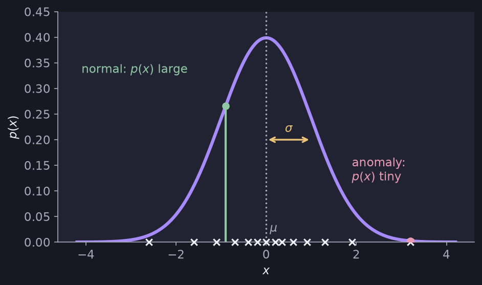

# Gaussian (Normal) Distribution

> **Source page:** 36 · The bell-shaped curve used to model how likely a value is.

Say $x$ is a number. The probability of $x$ is determined by a Gaussian with mean $\mu$ and variance $\sigma^2$:

$$
p(x) = \frac{1}{\sqrt{2\pi}\,\sigma}\,e^{-\frac{(x-\mu)^2}{2\sigma^2}}
$$

where the parameters are estimated from the $m$ examples as

$$
\mu = \frac{1}{m}\sum_{i=1}^{m}x^{(i)}
\qquad
\sigma^2 = \frac{1}{m}\sum_{i=1}^{m}\left(x^{(i)}-\mu\right)^2
$$

*Figure: points near $\mu$ have a high $p(x)$ (normal); a point far out in the tail has a very small $p(x)$ (anomaly), as in the source sketch.*

> **Note on the source:** the sketch labels the top of the vertical axis "1". The height of a Gaussian at its peak is $1/(\sqrt{2\pi}\sigma)$, which equals 1 only for one particular $\sigma$; the sketch is only a picture of the shape.

## Detailed Explanation

> **Additional Explanation:**  
> This explanation has been added to improve understanding and is not a direct transcription of the original handwritten notes.
>
> **What the curve says.** The Gaussian (bell curve) is a model of how values are spread around an average. Most values are close to the mean $\mu$, and far-away values become rarer and rarer. The height of the curve at $x$, $p(x)$, tells you how common values near $x$ are.
>
> **What the two parameters do.**
>
> - $\mu$ moves the centre of the curve left or right.
> - $\sigma$ sets the width. A small $\sigma$ makes a tall narrow bell; a large $\sigma$ a low wide one.
>
> **A useful fact.** About 68% of the values lie within one $\sigma$ of $\mu$, and about 95% within two $\sigma$.
>
> **Worked example.** Data: $1, 2, 3$.
>
> - $\mu = (1+2+3)/3 = 2$
> - $\sigma^2 = \frac{(1-2)^2+(2-2)^2+(3-2)^2}{3}=0.667$, so $\sigma\approx 0.816$
> - $p(2) = \frac{1}{\sqrt{2\pi}(0.816)}\approx 0.489$
> - $p(4) = 0.489\cdot e^{-\frac{(4-2)^2}{2(0.667)}} = 0.489\cdot e^{-3}\approx 0.024$
>
> The value 4 is much less likely than 2 under this model. This idea is the basis of [anomaly detection](05-anomaly-detection.md).
>
> **Note on the formula.** The source divides by $m$ when computing $\sigma^2$. Some textbooks divide by $m-1$; for large data the difference is tiny.
>
> **Common mistake.** Treating $p(x)$ as a probability that $x$ happens exactly. For a continuous value it is a *density*; compare values of $p(x)$ to each other rather than reading them as chances.

## Related topics

- Previous: [Choosing the value of K](03-choosing-k.md)
- Next: [Anomaly detection](05-anomaly-detection.md)