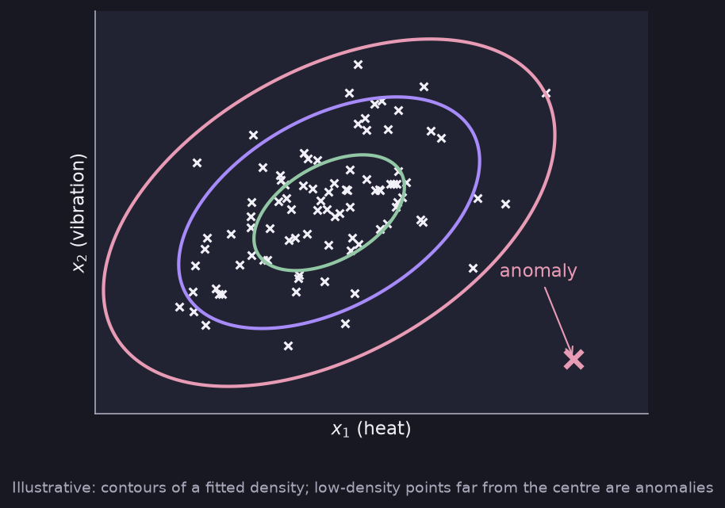

# Anomaly Detection (Intuition) and Choosing Features

> **Source pages:** 21 (algorithm intuition), 39 (top, choosing features)

## 1. Density estimation

**Example (from the source): aircraft engine**, with features $x_1$ (heat) and $x_2$ (vibration). Most engines form a dense cluster; a point far away is an **anomaly**.

*Figure: contours of a fitted density; the far-away point is an anomaly (illustrative).*

Model the **probability of $x$ being seen in the dataset**, $p(x)$. With $\varepsilon$ a small number (threshold probability):

$$
p(x_{test}) < \varepsilon \ \rightarrow\ \text{anomaly}
\qquad
p(x_{test}) \ge \varepsilon \ \rightarrow\ \text{normal}
$$

> **Note (from the source):** features can be taken as ratios for more efficiency. Feature engineering is crucial.

## 2. Choosing features

- Take Gaussian features, or convert to Gaussian by taking the log, etc. (the plot should look like a Gaussian curve).
- If for a feature $p(x)$ is comparable for both normal and anomalous examples, then **engineer a feature**.

## Detailed Explanation

> **Additional Explanation:**  
> This explanation has been added to improve understanding and is not a direct transcription of the original handwritten notes.
>
> **The goal.** Find the data points that do not look like the rest, such as an engine that behaves in an unusual way. We do this without examples of every kind of failure: we learn what *normal* looks like and flag what does not fit.
>
> **How the rule works.** Fit a model $p(x)$ to normal data (for example Gaussians as in the [previous note](04-gaussian-distribution.md)). A new point with a very small $p(x)$ is unlikely under the normal pattern, so it is flagged.
>
> **Applying it to the Gaussian example.** With $\varepsilon = 0.05$: $p(2)=0.489\ge\varepsilon$ is **normal**, while $p(4)=0.024<\varepsilon$ is an **anomaly**.
>
> **Choosing $\varepsilon$.**
>
> - If $\varepsilon$ is too large, many normal points are flagged (false alarms).
> - If $\varepsilon$ is too small, real anomalies are missed.
>
> It is tuned using a cross-validation set (see [Evaluating anomaly detection](06-evaluating-anomaly-detection.md)).
>
> **One common way to use several features.** With features such as heat and vibration, a typical approach is to model each feature with its own Gaussian and multiply the results: a point is unusual if at least one feature is very unusual.
>
> **Why features matter so much.** If a failure shows up only in a *combination* of features, no single feature looks odd. Creating a ratio feature (for example, one measurement divided by another) can make the failure stand out. That is why the source says feature engineering is crucial.
>
> **Making features Gaussian.** Taking the log of a skewed feature often makes its histogram look like a bell, which suits the model better.
>
> **Common mistake.** Keeping a feature whose $p(x)$ looks the same for normal and anomalous examples. It carries no signal.

## Related topics

- Previous: [Gaussian distribution](04-gaussian-distribution.md)
- Next: [Evaluating anomaly detection](06-evaluating-anomaly-detection.md)