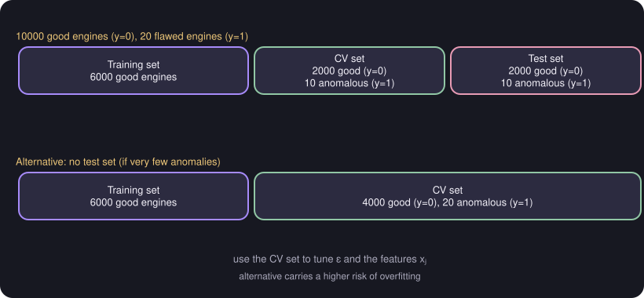

# Developing and Evaluating Anomaly Detection Systems

> **Source page:** 34

**Example (from the source): aircraft engine monitoring** with 10000 good engines ($y=0$) and 20 flawed engines ($y=1$).

*Figure: the two splits described in the source.*

## 1. Split with a test set

- Training set: 6000 good engines.
- CV: 2000 good engines ($y=0$), 10 anomalous ($y=1$).
- Test: 2000 good engines ($y=0$), 10 anomalous ($y=1$).

Use the CV set to tune the value of $\varepsilon$ and the features $x_j$.

## 2. Alternative: no test set (if very few anomalies)

- Training set: 6000 good engines (higher risk of overfitting).
- CV: 4000 good engines ($y=0$), 20 anomalous ($y=1$) — tune $\varepsilon$, $x_j$.

## 3. Evaluation

$$
y =
\begin{cases}
1 & \text{if } p(x) < \varepsilon\ \text{(anomaly)}\\
0 & \text{if } p(x) \ge \varepsilon\ \text{(normal)}
\end{cases}
$$

Possible evaluation metrics:

- True positive, false positive, true negative, false negative
- Precision / recall
- $F_1$-score

## Detailed Explanation

> **Additional Explanation:**  
> This explanation has been added to improve understanding and is not a direct transcription of the original handwritten notes.
>
> **Why a special data split.** Anomalies are very rare. In the source's example only 20 of 10 000 engines are flawed ($0.2\%$). A "detector" that always says *normal* would be right $9980/10\,000 = 99.8\%$ of the time, so accuracy is useless here. We need metrics that focus on the rare class.
>
> **What goes where.**
>
> - The **training set** contains only good engines. The model learns what normal looks like. No labels are needed here.
> - The **CV set** contains good engines and a few anomalies. It has labels, and is used to tune $\varepsilon$ and to decide which features to use.
> - The **test set** (if there is one) has the same kind of mix and gives a final check.
>
> The anomalies are shared between CV and test (10 each) because there are so few of them.
>
> **The alternative split.** With very few anomalies, you can skip the test set and put all 20 into the CV set. The price is a higher risk that the choices you made fit the CV set too closely (overfitting to it).
>
> **Tuning step by step.**
>
> 1. Fit $p(x)$ on the training set.
> 2. Compute $p(x)$ for each CV example and apply the rule $p(x)<\varepsilon \Rightarrow y=1$.
> 3. Score the result with precision, recall or $F_1$ (see [Precision, recall and F1](../03-model-evaluation-and-ml-practice/07-precision-recall-f1.md)).
> 4. Try other $\varepsilon$ values and features and keep what scores best.
>
> **Common mistake.** Putting anomalies in the training set. The point is to learn only the normal pattern.

## Related topics

- Previous: [Anomaly detection](05-anomaly-detection.md)
- Metric definitions: [Precision, recall and F1](../03-model-evaluation-and-ml-practice/07-precision-recall-f1.md)