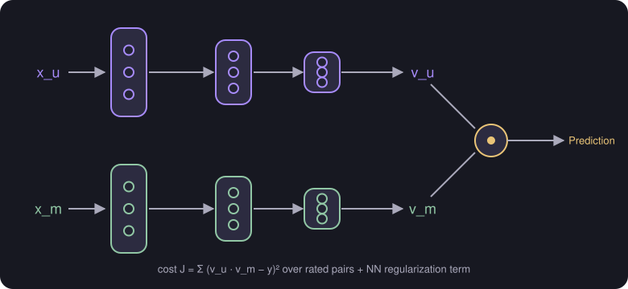

# Content-Based Filtering with Deep Learning

> **Source page:** 33 (top) · Two networks that turn user and movie features into vectors.

Predict the rating of user $j$ on movie $i$ as $\vec w^{(j)}\cdot\vec x^{(i)}+b^{(j)}$, which becomes a dot product of two vectors:

$$
v_u^{(j)}\cdot v_m^{(i)}
$$

- $v_u^{(j)}$ is computed from $x_u^{(j)}$ (user preference, e.g. $[4.9,\ 0.1,\ \dots,\ 3.0]$).
- $v_m^{(i)}$ is computed from $x_m^{(i)}$ (movie features, e.g. $[4.5,\ 0.2,\ \dots,\ 3.5]$, such as romance and action).

> **Note on the source:** the labels next to the user-preference vector are hard to read ([UNCLEAR IN SOURCE], p. 33); the labels next to the movie vector read "romance" and "action".

*Figure: one network maps $x_u$ to $v_u$, another maps $x_m$ to $v_m$; their dot product is the prediction.*

## Cost function

$$
J = \sum_{r(i,j)=1}\left(v_u^{(j)}\cdot v_m^{(i)}-y^{(i,j)}\right)^2 + \text{NN regularization term}
$$

## Detailed Explanation

> **Additional Explanation:**  
> This explanation has been added to improve understanding and is not a direct transcription of the original handwritten notes.
>
> **Why use two networks.** The user's features $x_u$ (age, country, past behaviour) and the movie's features $x_m$ (year, genre, reviews) are different kinds of information and can have different lengths. One network turns each user into a vector $v_u$, and a second network turns each movie into a vector $v_m$. Both vectors must have the **same length**, so that their dot product can be computed.
>
> **Reading the dot product.** If one component of $v_u$ means "likes romance" and the matching component of $v_m$ means "is romantic", then multiplying them is large when both are large. Adding such products up gives a score for how well movie and user match.
>
> **Tiny made-up example.** $v_u=[1,\ 0.5]$ and $v_m=[4,\ 2]$ give $1\cdot4+0.5\cdot2=5$.
>
> **Training.** The cost compares the dot product with the real rating for every pair that has one, and adds regularization for the networks. Training changes the weights of **both** networks together to reduce this cost.
>
> **The benefit.** Once trained, $v_m$ for each movie can be computed ahead of time. To recommend, you only need to compute $v_u$ for the current user and find movies with a high dot product, or to find similar movies using the distance between the $v_m$ vectors.
>
> **Common mistake.** Choosing different output sizes for the two networks. The dot product needs equal lengths.

## Related topics

- Previous: [Finding related items](06-finding-related-items.md)
- Next: [Retrieval and ranking](08-retrieval-and-ranking.md)