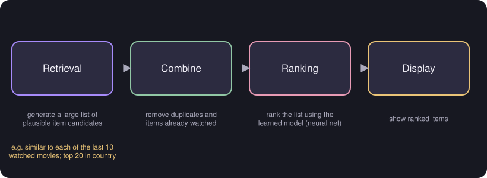

# Retrieval and Ranking

> **Source pages:** 33 (bottom, two steps), 32 (top, ranking and retrieval step)

*Figure: retrieve many candidates, combine them, rank them with the learned model, and display them.*

## Step 1: Retrieval

Generate a large list of plausible item candidates, for example:

- from each of the last 10 watched movies, find 10 similar ones;
- the top 20 movies in the country, etc.

Combine the retrieved items into a list, **removing duplicates and items already watched.**

## Step 2: Ranking

- Take the retrieved list and rank it using the learned model (the neural net).
- Display the ranked items.

## The retrieval step

- Retrieving more items results in better performance, but slower recommendations.
- To analyse or optimise the trade-off, carry out offline experiments.

> **Note (from the source):** "Amelioration" = filter out problematic content such as hate speech, fraud, scams and violent content.

## Detailed Explanation

> **Additional Explanation:**  
> This explanation has been added to improve understanding and is not a direct transcription of the original handwritten notes.
>
> **Why two steps.** A large service can have millions of items. Running the full neural network on every item for every visitor would take too long. So the job is split:
>
> 1. **Retrieval:** quickly build a shortlist of items that *might* be good.
> 2. **Ranking:** use the more careful (slower) model only on the shortlist, and sort it.
>
> **Building the shortlist.** The source's examples: from each of the user's last 10 watched films, take 10 similar ones; add the top 20 films in the user's country; and so on. Combine the lists, remove duplicates, and remove films already watched.
>
> **The trade-off.** A longer shortlist is more likely to include something the user would love, so recommendations are better. But ranking takes longer, so the page loads more slowly. How long the shortlist should be is found by **offline experiments**: try different lengths on stored data and measure both quality and speed.
>
> **Filtering unwanted items.** The note on "amelioration" says that problematic content (hate speech, fraud, scams, violent content) should be filtered out. This can be done as part of building or ranking the list.
>
> **Common mistake.** Making the shortlist very large "just in case". The speed cost may outweigh the gain.

## Related topics

- Previous: [Content-based filtering with deep learning](07-content-based-deep-learning.md)
- Next: [Reinforcement learning: return](09-reinforcement-learning-return.md)