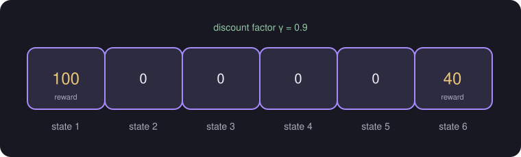

# Reinforcement Learning: Return and Discount Factor

> **Source page:** 32 (bottom) · The source notes "(Basics known)" and uses a Mars rover example.

## 1. Mars rover example

Six states in a row. State 1 has reward **100** and state 6 has reward **40**.

*Figure: the six states of the source's Mars rover example.*

## 2. Return

Discount factor $\gamma = 0.9$ (here).

$$
\text{Return} = R_1 + \gamma R_2 + \gamma^2 R_3 + \dots\ \text{(till terminal state)}
$$

The source's worked example:

$$
0 + (0.9)\,0 + (0.9)^2\,0 + (0.9)^3\,100 = 72.9
$$

> **Additional Explanation:**  
> This explanation has been added to improve understanding and is not a direct transcription of the original handwritten notes.  
> The source does not say which state the calculation starts from. The numbers match a path that collects three rewards of 0 and then the reward of 100 in state 1, for example starting in state 4 and moving left.

## Detailed Explanation

> **Additional Explanation:**  
> This explanation has been added to improve understanding and is not a direct transcription of the original handwritten notes.
>
> **The setting.** An agent (here, a rover) is in a *state* and receives a *reward* when it gets to certain states. It wants to collect as much total reward as possible.
>
> **What the discount factor does.** A reward that arrives later is worth a bit less. With $\gamma=0.9$, a reward after 3 steps is multiplied by $0.9^3=0.729$. Closer to 1 means the agent is more patient; closer to 0 means it cares mostly about rewards right now.
>
> **Extending the source's calculation** (an illustration using the same formula, moving left each time with $\gamma = 0.9$):
>
> | Start state | Return |
> |---|---|
> | 1 (terminal, reward 100) | 100 |
> | 2 | $0.9\times100 = 90$ |
> | 3 | $0.9^2\times100 = 81$ |
> | 4 | $0.9^3\times100 = 72.9$ |
> | 5 | $0.9^4\times100 = 65.61$ |
>
> The 72.9 in the source is exactly the value for state 4, which agrees with the idea that the number comes from heading left from state 4.
>
> **Why a return and not just a single reward.** Sometimes the best first move gives zero reward but leads to a big reward later. The return captures that.
>
> **Comparing the two goals.** From state 5, going left gives 65.61, but going right to state 6 gives 40 immediately. So the left route is better there. From state 6 itself the answer is already 40.
>
> **Common mistake.** Forgetting that the powers of $\gamma$ grow with the number of steps. The first reward is not discounted at all ($\gamma^0=1$).

## 3. Related topics

- Previous: [Retrieval and ranking](08-retrieval-and-ranking.md)
- Next: [Policy and the Q function](10-policy-and-q-function.md)