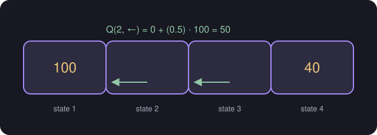

# Policy and the State-Action Value Function (Q)

> **Source page:** 41

## 1. Policy

By calculating the return for each square we get a **policy**. This includes a state $(s)$ and an action $(a)$.

A policy is a function $\pi(s)=a$: a mapping from states to actions that tells you what action $a$ to take in state $s$.

> **Find a policy that maximizes the return.**

> **Note (from the source):** all these methods are Markov Decision Processes.

## 2. State-action value function (Q function)

$Q(s,a)$. **Example (from the source):** four states with rewards 100 and 40 at the ends.

$$
Q(2,\leftarrow) = 0 + (0.5)\,100 = 50
$$

*Figure: from state 2, going left reaches state 1 and its reward of 100.*

> **Note on the source:** the values written inside the other cells of the sketch are hard to read ([UNCLEAR IN SOURCE], p. 41); only the $50$ is confirmed by the calculation. The factor $0.5$ is the discount factor used in that example.

## Detailed Explanation

> **Additional Explanation:**  
> This explanation has been added to improve understanding and is not a direct transcription of the original handwritten notes.
>
> **What a policy is.** A rule that says what to do in each state. For the rover, a policy might say "from states 2, 3 and 4 move left; from state 5 move right". Writing it as a function, $\pi(s)=a$. The best policy is the one with the highest return.
>
> **What $Q(s,a)$ means.** It is the return you would get if you start in state $s$, take action $a$ **once**, and then behave in the best possible way afterwards. It lets you compare actions directly.
>
> **Reading the source's example** ($\gamma=0.5$, four states, rewards 100 and 40 at the ends).
>
> - $Q(2,\leftarrow)=0+0.5\times100 = 50$: step left to state 1 and collect 100, discounted once.
>
> **Checking the other action** (an extra calculation with the same rule). Moving right from state 2 puts you in state 3, and from there the best plan is to go left: $0+0.5\times0+0.25\times100=25$. So $Q(2,\rightarrow)=0+0.5\times25=12.5$.
>
> Since $50>12.5$, the best action in state 2 is **left**.
>
> **Linking Q and the policy.** In each state the best action is the one with the largest $Q$:
>
> $$ \pi(s)=\arg\max_{a}Q(s,a) $$
>
> So if you know all the $Q$ values, you also know the best policy.
>
> **Markov decision process.** The source's note says these methods are Markov decision processes. In short, what happens next depends only on the current state and the chosen action, not on the earlier history.
>
> **Common mistake.** Reading $Q(s,a)$ as the reward of one step. It is the whole discounted return.

## Related topics

- Previous: [Return and discount factor](09-reinforcement-learning-return.md)