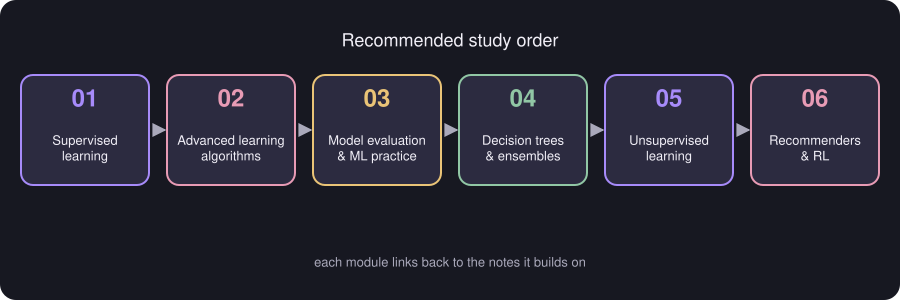

<p align="center">
  
</p>

# Machine Learning Notes

A set of digital notes made from **53 pages of handwritten Machine Learning notes**. The handwriting has been typeset, the equations rewritten in LaTeX, and the sketches redrawn as diagrams placed right next to the explanation they support.

**Who is it for?** University students learning Machine Learning who want short, structured notes for learning and revision.

> The notes follow the topics of the source and nothing else. Wherever the handwriting was unclear, or looked like a slip, it is flagged instead of silently fixed — see [TRANSCRIPTION_NOTES.md](TRANSCRIPTION_NOTES.md). Text added to help understanding is always marked **Additional Explanation**.

## Learning roadmap



1. Start with **supervised learning** — everything else builds on its cost functions and gradient descent.
2. Move to **neural networks**, which reuse those ideas.
3. Learn how to **evaluate and improve** models (bias, variance, error analysis).
4. Study **decision trees and ensembles** as the other major family of supervised models.
5. Continue with **unsupervised learning** (clustering, anomaly detection).
6. Finish with **recommender systems and reinforcement learning**.

## Table of contents

### [01 — Supervised Learning](01-supervised-learning/README.md)

Regression and classification: linear and logistic regression, gradient descent, feature scaling, overfitting and regularization.

1. [Linear Regression](01-supervised-learning/01-linear-regression.md)
2. [Linear Regression with Multiple Features](01-supervised-learning/02-multiple-features-and-vectorization.md)
3. [Feature Scaling](01-supervised-learning/03-feature-scaling.md)
4. [Gradient Descent in Practice](01-supervised-learning/04-gradient-descent-in-practice.md)
5. [Feature Engineering and Polynomial Regression](01-supervised-learning/05-feature-engineering-and-polynomial-regression.md)
6. [Decision Boundary](01-supervised-learning/06-decision-boundary.md)
7. [Logistic Loss, Cost and Gradient Descent](01-supervised-learning/07-logistic-loss-and-cost.md)
8. [Overfitting](01-supervised-learning/08-overfitting.md)
9. [Regularization](01-supervised-learning/09-regularization.md)

### [02 — Advanced Learning Algorithms](02-advanced-learning-algorithms/README.md)

Neural networks: layers, activation functions, softmax, vectorization, TensorFlow training steps, backpropagation, Adam.

1. [Neural Networks](02-advanced-learning-algorithms/01-neural-networks.md)
2. [Layer Computation (Intuition)](02-advanced-learning-algorithms/02-layer-computation.md)
3. [Activation Functions](02-advanced-learning-algorithms/03-activation-functions.md)
4. [Multiclass Classification and Softmax](02-advanced-learning-algorithms/04-multiclass-and-softmax.md)
5. [For Loop versus Vectorization (Dense Layer)](02-advanced-learning-algorithms/05-vectorization-dense-layer.md)
6. [TensorFlow and Model Training Steps](02-advanced-learning-algorithms/06-tensorflow-and-training-steps.md)
7. [Backpropagation versus Gradient Descent](02-advanced-learning-algorithms/07-backpropagation-vs-gradient-descent.md)
8. [Adam Algorithm and Types of Layers](02-advanced-learning-algorithms/08-adam-and-layer-types.md)

### [03 — Model Evaluation and ML Practice](03-model-evaluation-and-ml-practice/README.md)

Train/CV/test sets, model selection, bias and variance, learning curves, error analysis, metrics, transfer learning, deployment.

1. [Train / Cross-validation / Test Procedure](03-model-evaluation-and-ml-practice/01-train-cv-test.md)
2. [Model Selection](03-model-evaluation-and-ml-practice/02-model-selection.md)
3. [Bias and Variance](03-model-evaluation-and-ml-practice/03-bias-and-variance.md)
4. [Learning Curves and Debugging a Learning Algorithm](03-model-evaluation-and-ml-practice/04-learning-curves-and-debugging.md)
5. [Adding Data, Data Augmentation and Data Synthesis](03-model-evaluation-and-ml-practice/05-data-centric-improvements.md)
6. [ML Development and Error Analysis](03-model-evaluation-and-ml-practice/06-ml-development-and-error-analysis.md)
7. [Precision, Recall and the F1 Score](03-model-evaluation-and-ml-practice/07-precision-recall-f1.md)
8. [Transfer Learning](03-model-evaluation-and-ml-practice/08-transfer-learning.md)
9. [ML Project Cycle and Deployment](03-model-evaluation-and-ml-practice/09-ml-project-cycle-and-deployment.md)

### [04 — Decision Trees and Ensembles](04-decision-trees-and-ensembles/README.md)

Decision trees, entropy, information gain, one-hot encoding, regression trees, random forests, XGBoost.

1. [Decision Trees](04-decision-trees-and-ensembles/01-decision-trees.md)
2. [Entropy as a Measure of Impurity](04-decision-trees-and-ensembles/02-entropy.md)
3. [Information Gain](04-decision-trees-and-ensembles/03-information-gain.md)
4. [One-Hot Encoding](04-decision-trees-and-ensembles/04-one-hot-encoding.md)
5. [Regression Trees](04-decision-trees-and-ensembles/05-regression-trees.md)
6. [Sampling with Replacement and the Random Forest Algorithm](04-decision-trees-and-ensembles/06-random-forest.md)
7. [XGBoost (eXtreme Gradient Boosting)](04-decision-trees-and-ensembles/07-xgboost.md)
8. [Decision Trees versus Neural Networks](04-decision-trees-and-ensembles/08-trees-vs-neural-networks.md)

### [05 — Unsupervised Learning](05-unsupervised-learning/README.md)

K-means clustering, choosing K, the Gaussian distribution and anomaly detection.

1. [Clustering and K-Means](05-unsupervised-learning/01-clustering-and-k-means.md)
2. [K-Means Cost Function and Random Initialization](05-unsupervised-learning/02-k-means-cost-and-initialization.md)
3. [Choosing the Value of K (Elbow Method)](05-unsupervised-learning/03-choosing-k.md)
4. [Gaussian (Normal) Distribution](05-unsupervised-learning/04-gaussian-distribution.md)
5. [Anomaly Detection (Intuition) and Choosing Features](05-unsupervised-learning/05-anomaly-detection.md)
6. [Developing and Evaluating Anomaly Detection Systems](05-unsupervised-learning/06-evaluating-anomaly-detection.md)

### [06 — Recommenders and Reinforcement Learning](06-recommenders-and-reinforcement-learning/README.md)

Collaborative and content-based filtering, retrieval and ranking, return, policy and the Q function.

1. [Recommender Systems: Notation](06-recommenders-and-reinforcement-learning/01-recommender-systems-notation.md)
2. [Collaborative Filtering versus Content-Based Filtering](06-recommenders-and-reinforcement-learning/02-collaborative-vs-content-based.md)
3. [Collaborative Filtering: Cost Function and Gradient Descent](06-recommenders-and-reinforcement-learning/03-collaborative-filtering-cost.md)
4. [Collaborative Filtering with Binary Labels](06-recommenders-and-reinforcement-learning/04-binary-labels.md)
5. [Mean Normalization](06-recommenders-and-reinforcement-learning/05-mean-normalization.md)
6. [Finding Related Items](06-recommenders-and-reinforcement-learning/06-finding-related-items.md)
7. [Content-Based Filtering with Deep Learning](06-recommenders-and-reinforcement-learning/07-content-based-deep-learning.md)
8. [Retrieval and Ranking](06-recommenders-and-reinforcement-learning/08-retrieval-and-ranking.md)
9. [Reinforcement Learning: Return and Discount Factor](06-recommenders-and-reinforcement-learning/09-reinforcement-learning-return.md)
10. [Policy and the State-Action Value Function (Q)](06-recommenders-and-reinforcement-learning/10-policy-and-q-function.md)


## Repository features

- **Digitised notes** — every page of the handwritten PDF is accounted for.
- **Mathematical equations** — KaTeX/LaTeX equations that render on GitHub.
- **Embedded visualisations** — SVG diagrams and Matplotlib figures inside each topic page.
- **Structured learning sequence** — pages reordered by prerequisite, not by notebook order.
- **Student-friendly explanations** — every topic ends with a *Detailed Explanation* (intuition, worked examples, common mistakes), clearly labelled as an addition to the handwritten source.
- **Source audit** — [TRANSCRIPTION_NOTES.md](TRANSCRIPTION_NOTES.md) lists unclear handwriting, apparent errors and every added explanation.

## Navigation

- Each module folder has a `README.md` with its topic list.
- Each topic page ends with **Related topics** links to the previous, next and connected notes.
- Quick links: [Linear regression](01-supervised-learning/01-linear-regression.md) · [Neural networks](02-advanced-learning-algorithms/01-neural-networks.md) · [Bias and variance](03-model-evaluation-and-ml-practice/03-bias-and-variance.md) · [Decision trees](04-decision-trees-and-ensembles/01-decision-trees.md) · [K-means](05-unsupervised-learning/01-clustering-and-k-means.md) · [Recommenders](06-recommenders-and-reinforcement-learning/01-recommender-systems-notation.md)

## Optional: browse as a website

The same Markdown files can be viewed as a dark-themed documentation site (Midnight Lavender palette, search, KaTeX):

```bash
pip install -r requirements.txt
bash scripts/serve_site.sh          # opens http://127.0.0.1:8000
```

## Regenerating figures

```bash
pip install numpy matplotlib
python scripts/make_figures.py      # assets/figures/*.png
python scripts/make_diagrams.py     # assets/diagrams/*.svg
python scripts/build_indexes.py     # module READMEs, this README, mkdocs.yml
```

*Colour palette: background `#171821`, cards `#2C2B40`, accent `#A78BFA` / `#E89BB5`, maths `#EAC477`, success `#91C7A5`.*